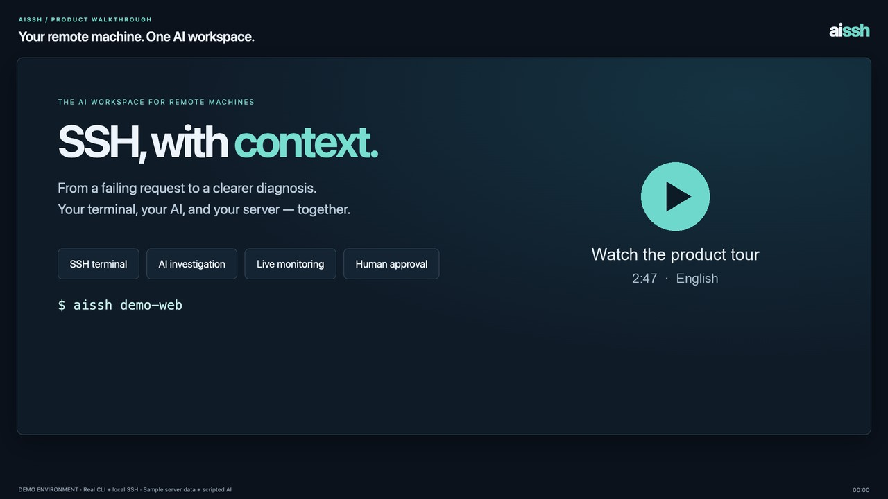

# aissh

**English** | [简体中文](README.zh-CN.md)

> **The AI workspace for remote machines.**
>
> Bring your AI coding agent, SSH terminal, live server state, and human-controlled execution into one workspace.

**aissh** is a local-first AI workspace for working with remote machines over SSH.

It lets you use **Codex, Claude Code, or other AI providers** alongside a normal SSH session — without installing an agent, daemon, or script on the target server.

## Product tour

[](docs/media/aissh-product-tour-en.mp4)

**[Watch the product tour — 2:47](docs/media/aissh-product-tour-en.mp4)** · English narration and captions.

See SSH connections, AI-assisted diagnosis, command approvals, live monitoring, local source code, and session history in one workflow. Recorded with the real CLI and local SSH, using sample server data and scripted AI responses.

<details>
<summary>Workspace layout</summary>

Illustrative layout with the sidebar open; the values and AI responses below are examples.

```text
┌───────────────────────────────────────┬───────────────────────────┐
│                                       │ Live Server State         │
│ SSH Terminal                          │                           │
│                                       │ CPU      12%              │
│ root@server:~# /ai                    │ Memory   48%              │
│ Why is nginx returning 502 errors?    │ Disk     62%              │
│                                       │ Network  1.2 MB/s         │
│ AI is investigating...                │                           │
│                                       ├───────────────────────────┤
│ AI: I found repeated upstream         │ AI Conversation           │
│ connection timeouts...                │                           │
│                                       │ Full context              │
│                                       │ Investigation history     │
└───────────────────────────────────────┴───────────────────────────┘
```

</details>

## Why aissh?

AI coding agents are becoming very good at operating a shell.

But working with a remote machine is more than running commands.

You need to:

* understand what is happening on the server
* inspect logs, processes, networking and services
* keep an eye on live system state
* connect production behavior with local source code
* review commands before they change anything
* remember what happened the last time you investigated the same server

With `aissh`, these things live in the same workspace.

```text
                AI Agent
                   │
       ┌───────────┼───────────┐
       │           │           │
   SSH Shell    Server State   Local Code
       │           │           │
       └───────────┼───────────┘
                   │
             Remote Machine
```

The goal is simple:

> **Make a remote machine feel like a first-class AI workspace.**

## No agent on the server

aissh uses your existing SSH connection.

Nothing needs to be installed on the target machine:

* no resident agent
* no daemon
* no custom script
* no additional server-side service

Your existing OpenSSH setup continues to work:

```bash
aissh production
aissh root@192.0.2.1
aissh -p 2222 production
aissh -J bastion internal-server
```

Existing `~/.ssh/config`, keys, SSH agent, jump hosts, and OpenSSH options remain usable.

The desktop session's **Bastion compatibility mode** switch, beside terminal takeover, is off by default. When enabled, approved commands are typed verbatim without added `eval`, subshells, or completion markers. Single-line commands are collected automatically only after remote Shell Integration events; otherwise click **Collect output**. Multiline commands always require manual collection. Prompt regexes cannot trigger collection. Collecting output sends no Ctrl+C and does not assert that the remote command has finished. For the CLI, use `--bastion-compatibility` and Ctrl+Y to collect output.

Automatic system collection is off by default. Explicitly requested monitor probes and mapping verification still require script approval and run once without enabling recurring collection. Manually collected monitor receipts preserve output with an unknown exit status; monitoring maps require a verified successful receipt.

This is intentional.

**aissh changes your local workflow, not your server infrastructure.**

---

## What you can do

### 🤖 Ask AI directly from SSH

Stay in the terminal and ask the AI about the problem you're working on.

```text
root@server:~# /ai why is nginx returning 502 errors?

AI:
I found repeated upstream connection timeouts.
Let's inspect the upstream service and current connection count.
```

You don't need to:

1. copy terminal output
2. switch to another AI application
3. paste the logs
4. copy a command back
5. return to SSH

The AI stays in the SSH workflow.

---

### ⚡ Let AI investigate the problem

aissh can use command output and the current server context to continue an investigation.

For example:

```text
You:
Why is this service restarting?

AI:
I'll check the service status and recent logs.

→ systemctl status myservice
→ journalctl -u myservice --since "10 minutes ago"

AI:
The process is being killed because it exceeds the memory limit.
Let's inspect the recent memory usage before changing anything.
```

The investigation commands run after you approve them, and their output is returned to the AI for further analysis.

The important part is not that AI can run commands.

**Modern coding agents can already do that.**

The point of aissh is that the agent operates inside a workspace designed around the remote machine.

---

### 🛡️ AI proposes. You decide.

AI-generated remote shell commands are not executed automatically by default.

Every proposed command can show:

* what it does
* expected effect
* risk level

You decide whether to run it.

```text
AI proposes:

sudo systemctl restart nginx

Risk: medium

Run this command? [yes/no]
```

High-risk commands are explicitly highlighted.

For trusted environments, `--always-yes` enables automatic approval of commands below high risk after three independent AI risk reviews. High-risk or critical commands, unknown results, changed commands, and failed reviews still require manual confirmation.

The default philosophy is:

> **AI can investigate and propose. The human remains in control of changes.**

---

### 📊 Live server state beside the terminal

aissh includes a monitoring workspace directly inside the SSH interface. The sidebar is hidden by default; enter `/sidebar show` at the SSH prompt to open it in a terminal at least 92 columns wide.

You can display:

* system health
* CPU / memory
* processes
* disks
* networking
* services
* custom monitors

For example:

```text
┌────────────────────────┬────────────────────────┐
│ System                 │ Processes              │
│ CPU       18%          │ nginx       3.2%       │
│ Memory    42%          │ java       21.4%       │
│ Load      1.82         │ postgres    8.1%       │
├────────────────────────┼────────────────────────┤
│ Network                │ Services               │
│ RX       1.2 MB/s      │ nginx       running    │
│ TX       0.8 MB/s      │ docker      running    │
└────────────────────────┴────────────────────────┘
```

AI can open or update monitoring panels while investigating a problem.

Built-in read-only collectors run automatically. Custom collection scripts require manual approval before their first run and when their configuration changes; approval covers recurring collection at the displayed interval. Available metrics depend on the tools and permissions on the target machine.

So instead of:

```text
AI chat → terminal → monitoring tool → logs → browser
```

the investigation happens in one place.

---

## Local code + remote machine

When using the local Codex or Claude Code backend, one of the most useful workflows is debugging a running application together with its source code.

For example:

```bash
cd ~/projects/my-service
aissh production
```

Now the AI can reason about:

```text
Local source code
       +
Production logs
       +
Remote processes
       +
Remote configuration
       +
Current system state
```

Ask:

> Why is the production API returning this error?

The AI can inspect the relevant local code and compare it with what is happening on the remote machine.

Local workspace access is read-only by default.

Direct DeepSeek and OpenAI-compatible model backends use the supplied SSH context and do not read your local workspace.

If you explicitly enable write access:

```bash
aissh --workspace-write production
```

the AI can modify the local project according to the configured provider's permissions.

**Local code is never automatically uploaded or deployed to the server.**

---

## A separate AI context for every server

Different servers have different problems.

aissh keeps AI conversations locally and associates them with SSH targets.

You can:

* continue an earlier investigation
* review previous conversations
* start a fresh investigation
* keep context separated between servers

Enter `/ai` to focus the AI conversation, then press `Ctrl+R` to browse saved sessions. Use `--no-history` to disable loading and saving local history.

So when you return to a server later, you don't always have to explain the problem again.

---

## Works with the AI tools you already use

aissh is not another AI model.

Use the AI provider you already prefer.

Currently supported:

* **Codex** — local CLI, the default (`--agent codex`)
* **Claude Code** — local CLI (`--agent claude`)
* **DeepSeek** — direct API (`--agent deepseek`)
* **OpenAI-compatible providers** — direct API (`--agent model`)
* **HTTP Agent endpoint** — configurable backend (`--agent http`)

The goal is to keep the Agent layer replaceable.

```text
              aissh
                │
       ┌────────┼────────┐
       │        │        │
     Codex    Claude    Other
       │        │        │
       └────────┼────────┘
                │
             SSH / OS
                │
          Remote Machine
```

aissh focuses on the layer around the Agent:

**SSH + remote context + terminal + monitoring + execution control + history.**

---

## When is aissh useful?

### Diagnose a production problem

```text
"Why did nginx start returning 502s?"
```

### Understand an unfamiliar server

```text
"Give me an overview of what's running on this machine."
```

### Investigate a performance problem

```text
"Why is the load average so high?"
```

### Connect production behavior with source code

```text
"Find the code responsible for this error and compare it with the production logs."
```

### Watch a server while fixing it

```text
"Monitor CPU, memory and connections while I restart the service."
```

### Return to an old problem

```text
"What did we find the last time this server had this issue?"
```

---

## Quick Start

### Requirements

* macOS, Linux, or Windows with ConPTY support
* Go 1.25+ to build from source
* OpenSSH client and an interactive terminal
* a supported AI provider (authenticated local CLI or configured API)

Build from source (macOS / Linux shell examples):

```bash
git clone https://github.com/friparia/aissh.git
cd aissh

go test ./...
go build -o bin/aissh ./cmd/aissh
```

The [Build CLI workflow](https://github.com/yuliyang2023/aissh/actions/workflows/build.yml) builds macOS, Linux, and Windows CLI binaries for x86_64 (`amd64`) and aarch64 (`arm64`) on pushes to `main`, `v*` tags, pull requests, and manual runs. Download the archive and `SHA256SUMS` from a run's artifacts. macOS/Linux packages use `.tar.gz`; Windows packages use `.zip` and contain `aissh.exe`.

To build all six packages locally, run `make dist` (Go and `zip` required). Set `BUILD_TARGETS=windows/arm64` to build a single target. Packages are written to `dist/`.

The default backend is the local Codex CLI. Install and sign in to it, then verify it works:

```bash
codex exec --ephemeral "reply with ok only"
```

Then connect normally:

Codex threads are deleted on exit by default. Use `bin/aissh --keep-codex-session production` or `AISSH_KEEP_CODEX_SESSION=1` to retain them. The AI conversation displays and saves `codex resume <thread-id>` for continuing in a local terminal on the same computer. `--no-keep-codex-session` forces deletion; CLI flags override the environment and saved AI profile. The desktop AI profile has a retention checkbox that applies to the next connection, with a copyable resume command in both live conversations and offline history.

```bash
bin/aissh production
```

Or connect directly:

```bash
bin/aissh root@192.0.2.1
```

After connecting, ask a question or open the sidebar:

```text
/ai why is nginx returning 502 errors?
/sidebar show
```

### Choose an AI provider

For Claude Code, install and sign in to the local `claude` CLI, then run:

```bash
bin/aissh --agent claude production
```

For DeepSeek:

```bash
export DEEPSEEK_API_KEY='...'
bin/aissh --agent deepseek production
```

For another OpenAI-compatible API:

```bash
export AISSH_MODEL_URL='https://model.example/v1'
export AISSH_MODEL_API_KEY='...'
export AISSH_MODEL_NAME='your-model'
bin/aissh --agent model production
```

Run `bin/aissh --help` for all options.

### More documentation

* [Usage and configuration guide (Chinese)](docs/usage.zh-CN.md)
* [Desktop client and credentials (Chinese)](docs/desktop.md)
* [Native iOS client (Chinese)](ios/README.md)

---

## Design principles

### Local-first

Your SSH credentials, conversations, and local workspace remain under your control.

AI requests go to your configured provider and may include your question, relevant SSH output, command results, and local code context when using a local coding agent.

### No server agent

Use standard SSH and the target machine's existing tools. No resident agent, daemon, or preinstalled collection script is required.

### Human in the loop

AI can reason and propose. Changes remain subject to explicit permission by default.

### Agent-agnostic

aissh should work with the AI agent you prefer rather than locking the workflow to one model.

### Terminal-native

aissh is designed around the workflow experienced engineers already know instead of replacing SSH with an entirely new abstraction.

### Small surface area

The target is not another enterprise operations platform.

It is a better way to work with remote machines.

---

## Roadmap

The project is intentionally early.

Possible directions include:

* richer remote system context
* more infrastructure-aware tools
* Docker / Kubernetes workflows
* better multi-server workflows
* more AI providers
* extensible plugins
* safer command execution
* remote debugging workflows
* improved local-code / remote-runtime integration

The roadmap will be driven by real-world usage rather than trying to build an all-in-one operations platform.

---

## Contributing

Issues, ideas, experiments and pull requests are welcome.

If you use aissh on real servers, feedback about your workflow is especially valuable.

Tell us:

* what you were trying to do
* what you expected AI to understand
* where the workflow felt awkward
* what you still had to do manually

---

## License

This repository does not currently include a LICENSE file.

---

> **aissh is not trying to replace SSH.**
>
> **It is trying to make the remote machine a first-class workspace for AI-assisted engineering.**
