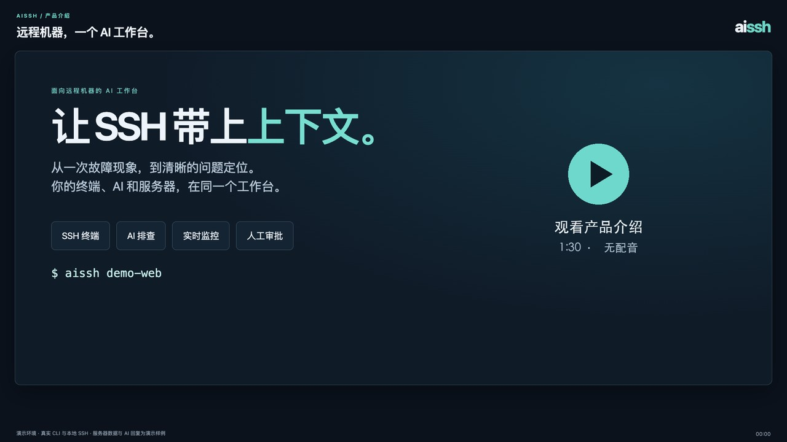

# aissh

[English](README.md) | **简体中文**

> **面向远程机器的 AI 工作台。**
>
> 将 AI 编程助手、SSH 终端、实时服务器状态和由你掌控的命令执行，整合到同一个工作台。

**aissh** 是一个本地优先的 AI 工作台，用于通过 SSH 操作和维护远程机器。

你可以在正常使用 SSH 的同时，借助 **Codex、Claude Code 或其他 AI 后端**开展工作，无需在目标服务器上安装 Agent、守护进程或脚本。

## 产品介绍视频

[](docs/media/aissh-product-tour-zh.mp4)

**[观看产品介绍视频 — 1 分 30 秒](docs/media/aissh-product-tour-zh.mp4)** · 中文无声演示，含简要操作提示。

完整演示 SSH 连接、AI 故障排查、命令审批、实时监控、本地源码关联和历史会话。视频使用真实 CLI 与本地 SSH 录制，服务器数据和 AI 回复为演示样例。

<details>
<summary>工作台布局示意</summary>

以下为展开侧栏后的布局示意，文中的数值和 AI 回答均为示例。

```text
┌───────────────────────────────────────┬───────────────────────────┐
│                                       │ 实时服务器状态            │
│ SSH 终端                              │                           │
│                                       │ CPU      12%              │
│ root@server:~# /ai                    │ 内存     48%              │
│ 为什么 nginx 返回 502？               │ 磁盘     62%              │
│                                       │ 网络     1.2 MB/s         │
│ AI 正在排查……                         │                           │
│                                       ├───────────────────────────┤
│ AI：发现多次上游连接超时……            │ AI 对话                   │
│                                       │                           │
│                                       │ 完整上下文                │
│                                       │ 排查历史                  │
└───────────────────────────────────────┴───────────────────────────┘
```

</details>

## 为什么需要 aissh？

AI 编程助手已经越来越擅长操作 Shell。

但维护一台远程机器，需要做的远不止执行命令。

你还需要：

* 了解服务器上正在发生什么
* 检查日志、进程、网络和服务
* 持续观察系统的实时状态
* 将线上运行表现与本地源码联系起来
* 在命令造成变更前进行审查
* 记住上一次排查这台服务器时的发现

借助 `aissh`，这些工作可以在同一个工作台中完成。

```text
                  AI 助手
                     │
         ┌───────────┼───────────┐
         │           │           │
     SSH Shell   服务器状态   本地代码
         │           │           │
         └───────────┼───────────┘
                     │
                  远程机器
```

目标很简单：

> **让远程机器成为 AI 可以直接参与工作的完整工作空间。**

## 服务器无需安装 Agent

aissh 使用你现有的 SSH 连接。

目标机器上无需额外安装：

* 常驻 Agent
* 守护进程
* 自定义脚本
* 额外的服务端服务

原有的 OpenSSH 连接方式可以继续使用：

```bash
aissh production
aissh root@192.0.2.1
aissh -p 2222 production
aissh -J bastion internal-server
```

已有的 `~/.ssh/config`、密钥、SSH Agent、跳板机和 OpenSSH 参数都可以继续使用。

桌面会话中，“取消 AI，接管终端”旁边的“堡垒机兼容模式”默认关闭。开启后，已批准的命令逐字符原样发送，不添加 `eval`、子 Shell 或结束标记。单行命令只在收到远端 Shell Integration 控制序列时自动收集；没有集成或使用多行命令时，点击“收集输出”。提示符正则不会触发自动收集，收集操作不会发送 Ctrl+C，也不会断言远端命令已经结束。CLI 使用 `--bastion-compatibility` 开启，按 Ctrl+Y 手动收集。

自动系统采集默认关闭。用户明确请求的监控首采和映射验证仍会进入脚本审批；批准后执行该次采集，不会开启后台周期采集。兼容模式下手动收集的监控回执会保留输出并标记退出状态未知；缺少成功退出回执时，不会通过监控映射验证。

这是 aissh 的设计出发点。

**aissh 改变的是你的本地工作方式，无需改造服务器基础设施。**

---

## 你可以用它做什么

### 🤖 直接在 SSH 中向 AI 提问

留在终端里，直接向 AI 描述当前遇到的问题。

```text
root@server:~# /ai 为什么 nginx 一直返回 502？

AI：
发现多次上游连接超时。
接下来可以检查上游服务和当前连接数。
```

你无需反复：

1. 复制终端输出
2. 切换到另一个 AI 应用
3. 粘贴日志
4. 把建议的命令复制回来
5. 返回 SSH 执行

AI 就在你的 SSH 工作流中。

---

### ⚡ 让 AI 协助排查问题

aissh 可以结合命令输出和当前服务器上下文，继续深入排查。

例如：

```text
你：
为什么这个服务一直在重启？

AI：
我会先检查服务状态和最近的日志。

→ systemctl status myservice
→ journalctl -u myservice --since "10 minutes ago"

AI：
进程因超过内存限制而被终止。
在修改配置之前，先看看最近的内存使用情况。
```

排查命令在你批准后执行，输出会交给 AI 继续分析。

AI 能运行命令，本身并不稀奇。

**现代编程助手已经具备这种能力。**

aissh 的价值在于，让 AI 在一个围绕远程机器设计的工作台中开展工作。

---

### 🛡️ AI 提建议，你来做决定

默认情况下，AI 生成的远程 Shell 命令不会自动执行。

每条命令建议都可以展示：

* 命令的用途
* 预期效果
* 风险等级

由你决定是否执行。

```text
AI 建议：

sudo systemctl restart nginx

风险：中等

执行这条命令？[yes/no]
```

高风险命令会有醒目标记。

在可信环境中，可以通过 `--always-yes` 开启自动审批：低于高风险的命令须通过三次独立的 AI 风险复核，才会自动执行。高风险或严重风险命令、结果未知、命令发生变化或复核失败时，仍需手动确认。

默认原则是：

> **AI 负责分析和建议，变更的决定权保留在你手中。**

---

### 📊 在终端旁查看实时服务器状态

aissh 将监控工作台直接集成到 SSH 界面。侧栏默认收起；终端宽度至少为 92 列时，在 SSH 提示符输入 `/sidebar show` 即可展开。

你可以查看：

* 系统健康状态
* CPU / 内存
* 进程
* 磁盘
* 网络
* 服务
* 自定义监控

例如：

```text
┌────────────────────────┬────────────────────────┐
│ 系统                   │ 进程                   │
│ CPU       18%          │ nginx       3.2%       │
│ 内存      42%          │ java       21.4%       │
│ 负载      1.82         │ postgres    8.1%       │
├────────────────────────┼────────────────────────┤
│ 网络                   │ 服务                   │
│ RX       1.2 MB/s      │ nginx       运行中     │
│ TX       0.8 MB/s      │ docker      运行中     │
└────────────────────────┴────────────────────────┘
```

AI 可以在排查过程中打开或更新监控面板。

内置只读采集器会自动运行。自定义采集脚本首次运行及配置变更时需要人工审批，批准后按界面展示的周期重复采集。可用指标取决于目标机器上的工具和访问权限。

原本需要来回切换的流程：

```text
AI 对话 → 终端 → 监控工具 → 日志 → 浏览器
```

可以集中在一个工作台里完成。

---

## 本地代码 + 远程机器

使用本机 Codex 或 Claude Code 后端时，一个很实用的工作方式是将运行中的应用与它的源码结合起来排查。

例如：

```bash
cd ~/projects/my-service
aissh production
```

此时，AI 可以综合分析：

```text
本地源码
   +
线上日志
   +
远程进程
   +
远程配置
   +
当前系统状态
```

你可以问：

> 为什么线上 API 会返回这个错误？

AI 可以查看相关的本地代码，并与远程机器上的实际表现进行对照。

本地工作区默认只读。

直连 DeepSeek 和 OpenAI-compatible 模型后端使用传入的 SSH 上下文，不会读取本地工作区。

如果显式开启写入权限：

```bash
aissh --workspace-write production
```

AI 就可以按照所配置后端的权限修改本地项目。

**本地代码不会自动上传或部署到目标服务器。**

---

## 每台服务器都有独立的 AI 上下文

不同服务器，有不同的问题。

aissh 将 AI 对话保存在本机，并与对应的 SSH 目标关联。

你可以：

* 继续之前的排查
* 回顾历史对话
* 开始一次新的排查
* 为不同服务器保留各自的上下文

输入 `/ai` 进入 AI 对话后，按 `Ctrl+R` 可以浏览已保存的会话。使用 `--no-history` 可以关闭本地历史的加载与保存。

下次回到同一台服务器时，就不必总是从头解释问题。

---

## 使用你已经熟悉的 AI 工具

aissh 本身不是一个 AI 模型。

你可以选择自己偏好的 AI 后端。

目前支持：

* **Codex** — 本机 CLI，默认后端（`--agent codex`）
* **Claude Code** — 本机 CLI（`--agent claude`）
* **DeepSeek** — 直连 API（`--agent deepseek`）
* **OpenAI-compatible 服务** — 直连 API（`--agent model`）
* **HTTP Agent 端点** — 可配置的后端（`--agent http`）

目标是让 Agent 层可以替换。

```text
                aissh
                  │
         ┌────────┼────────┐
         │        │        │
       Codex    Claude    其他
         │        │        │
         └────────┼────────┘
                  │
               SSH / OS
                  │
               远程机器
```

aissh 专注于 Agent 周围的工作环境：

**SSH + 远程上下文 + 终端 + 监控 + 执行控制 + 历史记录。**

---

## aissh 适合哪些场景？

### 排查线上故障

```text
“为什么 nginx 开始返回 502？”
```

### 了解一台陌生的服务器

```text
“帮我概览一下这台机器上正在运行什么。”
```

### 排查性能问题

```text
“为什么系统负载这么高？”
```

### 将线上表现与源码关联起来

```text
“找到与这个错误相关的代码，并和线上日志对照分析。”
```

### 一边处理问题，一边观察服务器

```text
“在我重启服务时，监控 CPU、内存和连接状态。”
```

### 继续排查曾经出现的问题

```text
“这台服务器上次出现这个问题时，我们发现了什么？”
```

---

## 快速开始

### 环境要求

* macOS、Linux，或支持 ConPTY 的 Windows
* 从源码构建需要 Go 1.25+
* OpenSSH 客户端和交互式终端
* 受支持的 AI 后端（已登录的本机 CLI 或已配置的 API）

从源码构建（以下为 macOS / Linux Shell 示例）：

```bash
git clone https://github.com/friparia/aissh.git
cd aissh

go test ./...
go build -o bin/aissh ./cmd/aissh
```

[Build CLI workflow](https://github.com/yuliyang2023/aissh/actions/workflows/build.yml) 会在推送 `main` 分支、推送 `v*` 标签、创建或更新 PR，以及手动运行时，编译 macOS、Linux、Windows 的 x86_64（`amd64`）和 aarch64（`arm64`）CLI。可在运行记录的 Artifacts 中下载压缩包和 `SHA256SUMS` 校验文件。macOS/Linux 使用 `.tar.gz`，Windows 使用 `.zip`，其中包含 `aissh.exe`。

本地运行 `make dist` 可生成全部六种包（需要 Go 和 `zip`）。设置 `BUILD_TARGETS=windows/arm64` 可只构建一个目标。产物保存在 `dist/`。

默认后端是本机 Codex CLI。安装并登录后，先确认它可以正常工作：

```bash
codex exec --ephemeral "只回答 ok"
```

然后照常连接：

Codex 会话默认在退出时删除。使用 `bin/aissh --keep-codex-session production` 或 `AISSH_KEEP_CODEX_SESSION=1` 可保留会话；AI 对话会显示并保存 `codex resume <thread-id>`，退出后可在同一台电脑的终端继续。`--no-keep-codex-session` 强制删除，启动参数优先于环境变量及保存的 AI 配置。桌面端可在「设置 → AI 配置」开启「退出后保留 Codex 会话」（下次连接生效），在线对话和离线历史均提供复制恢复命令入口。

```bash
bin/aissh production
```

也可以直接指定地址：

```bash
bin/aissh root@192.0.2.1
```

连接后，可以提问或展开侧栏：

```text
/ai 为什么 nginx 一直返回 502？
/sidebar show
```

### 选择 AI 后端

使用 Claude Code 时，先安装并登录本机 `claude` CLI，再运行：

```bash
bin/aissh --agent claude production
```

使用 DeepSeek：

```bash
export DEEPSEEK_API_KEY='...'
bin/aissh --agent deepseek production
```

使用其他 OpenAI-compatible API：

```bash
export AISSH_MODEL_URL='https://model.example/v1'
export AISSH_MODEL_API_KEY='...'
export AISSH_MODEL_NAME='your-model'
bin/aissh --agent model production
```

运行 `bin/aissh --help` 查看完整参数。

### 更多文档

* [使用与配置指南](docs/usage.zh-CN.md)
* [桌面客户端与凭据管理](docs/desktop.md)
* [iOS 原生客户端](ios/README.md)

---

## 设计原则

### 本地优先

SSH 凭据、对话记录和本地工作区由你掌控。

AI 请求会发送到你配置的后端，可能包含问题、相关 SSH 输出、命令执行结果，以及使用本机编程助手时的本地代码上下文。

### 服务器无需 Agent

使用标准 SSH 和目标机器上已有的工具，无需常驻 Agent、守护进程或预装采集脚本。

### 人工参与决策

AI 可以分析和建议，变更默认需要明确授权。

### 不绑定特定 Agent

aissh 应当支持你偏好的 AI 助手，让工作流不受单一模型限制。

### 围绕终端设计

aissh 围绕工程师熟悉的工作方式设计，让已有的 SSH 经验可以直接沿用。

### 保持轻量

目标不是再做一套企业级运维平台。

而是让远程机器上的工作更顺手。

---

## 路线图

项目仍处于早期阶段。

可能的发展方向包括：

* 更丰富的远程系统上下文
* 更多理解基础设施的工具
* Docker / Kubernetes 工作流
* 更完善的多服务器工作流
* 更多 AI 后端
* 可扩展的插件
* 更安全的命令执行
* 远程调试工作流
* 更紧密的本地代码与远程运行环境协作

路线图将由真实使用需求推动，保持对远程工作体验的专注。

---

## 参与贡献

欢迎提交 Issue、想法、实验和 Pull Request。

如果你在真实服务器上使用 aissh，关于工作流程的反馈尤其有帮助。

请告诉我们：

* 你当时想完成什么
* 你希望 AI 理解哪些信息
* 哪些环节用起来不顺手
* 哪些工作仍然需要手动完成

---

## 许可证

当前仓库尚未包含 LICENSE 文件。

---

> **aissh 无意替代 SSH。**
>
> **它希望让远程机器成为 AI 辅助工程工作的完整工作空间。**
