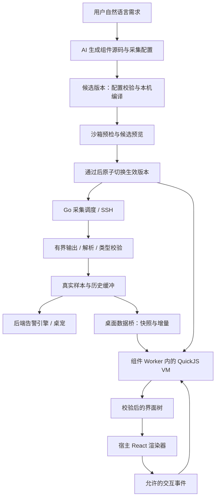
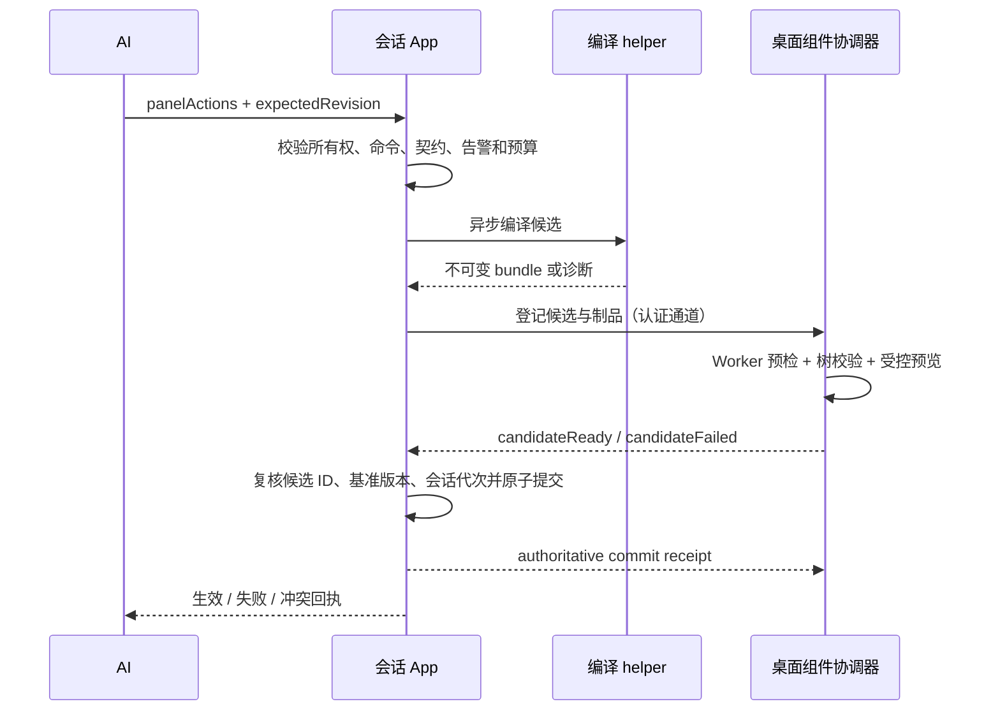

# AI 自定义实时监控组件架构

状态：架构设计，2026-09-26；核心流程已有首版实现。实际支持范围、代码入口、验证方式和与设计的差异见 [首版实现与使用说明](custom-monitor-components.md)。本文保留目标架构，未列入实现说明的协议字段、性能目标和后续能力不代表已经交付。

## 1. 设计结论

采用 **AI 编写 TSX 组件 → 本机编译 → Worker 内 QuickJS 沙箱执行 → 校验界面描述 → 宿主 React 渲染**。SSH 采集、数据历史和告警由 Go 管理。组件生成或修改时调用 AI，普通采样和界面刷新不调用 AI。

组件作者可以写函数、条件、循环、自定义子组件、布局、SVG 和交互逻辑。TSX 经专用 JSX runtime 生成界面描述树，这是内部传输协议，用户无需编辑界面 JSON。基础指标卡和图表用于复用，不限制用户只能选择预置看板。

第一版提供 `@wrd/monitor-ui` SDK，采用明确的 `render + state + events` 生命周期。**TSX 是组件编写语法，不承诺完整 React DOM、React Hooks 或任意 npm 包兼容。** 宿主继续使用项目现有的 React。需要直接操作 DOM、运行第三方网页或加载浏览器插件的能力属于后续独立扩展，不混入首版。

首版范围：单 SSH 会话、单采集源的自定义监控；自由组合布局、指标卡、趋势图、表格、状态和过滤交互；自然语言修改；保存组件定义、版本回退。多源关联、跨主机看板、外联系统采集和完整浏览器插件环境留出接口，后续实现。

## 2. 为什么选这个运行方式

| 方式 | 自定义能力 | 隔离和恢复 | 决策 |
| --- | --- | --- | --- |
| 在主页面执行模型生成的 React/JS | 完整浏览器能力 | 代码进入持有 Wails 接口的环境，同步死循环影响主界面 | 不采用 |
| sandbox iframe 执行 React/JS | 接近完整浏览器能力 | DOM 可隔离；仍需核验原生桥、导航和资源请求，不能仅靠 iframe 保证独立线程和强制中止 | 不作为首版运行底座 |
| 直接在 Worker 执行生成的 JS | 无真实 DOM，需远程渲染 | 可终止；Worker 本身仍有浏览器能力，需要进一步收窄 | 不直接加载模型代码 |
| Worker 内 QuickJS + 界面描述协议 | 自定义 TSX、计算和交互；受控 HTML/SVG 与图表 | 不向 VM 提供宿主权限；VM 预算和 Worker 终止分层控制 | 首版采用 |

iframe 的源隔离依据见 [MDN iframe](https://developer.mozilla.org/en-US/docs/Web/HTML/Reference/Elements/iframe)。当前 Wails 2.15.0 本地源码已经包含原生绑定来源检查，macOS 还拒绝非主框架绑定请求；这些检查不能等同于所有运行时能力、资源消耗都已隔离。Wails 也有自动注入 IPC/runtime 的机制，详见 [Wails 前端说明](https://wails.io/docs/guides/frontend/)。

QuickJS 的 WASM 封装提供内存限制与执行中断接口，Worker 提供终止能力；这些原语支持上述设计，但不证明本项目的实现已经安全或满足性能指标。见 [quickjs-emscripten](https://github.com/justjake/quickjs-emscripten)、[Worker.terminate](https://developer.mozilla.org/en-US/docs/Web/API/Worker/terminate)。界面在隔离环境计算、宿主负责实际显示的模式可参考 [Shopify Remote DOM](https://github.com/Shopify/remote-dom)；首版使用范围较小的自有协议，不直接承诺引入其完整 DOM 模拟层。

## 3. 总体结构与现有接入点



数据和 UI 是两条独立生命周期：组件崩溃只影响展示；关闭整个监控项目才停止该项目的采集和告警。隐藏页签或收起监控可以销毁 Worker，后端仍采集；重新显示时从后端恢复历史。

| 当前代码 | 已有能力或限制 | 设计调整 |
| --- | --- | --- |
| `internal/agent/client.go`、`codex.go`、`monitor_prompt.go` | AI 通过 `panelActions` 提交命令和面板；提示词限制纯文本 | 增加组件能力声明、源码、数据协议与版本条件；不同 AI provider 同步适配 |
| `internal/app/panel_actions.go` | 校验完整候选后更新面板；AI 只能改自己创建的非固定面板 | 保留所有权限制，增加异步组件候选事务；编译不能阻塞 app 事件循环 |
| `internal/app/app.go`、`inband_monitor.go`、`internal/monitor/runner.go` | 独立 SSH/已认证主通道采集；按命令字符串丢弃部分旧结果 | 两条通道接入共同结果协议，用采集代次和运行 ID 判断有效性 |
| `internal/panel/panel.go` | 区分展示 `Content` 与真实 `SampleContent`；有 `SourceRevision` | 保留真实性边界，增加类型化样本、来源版本与成功/失败时间 |
| `internal/app/desktop.go` | 展示文本会截为 16000 字符；错误也更新 `LastUpdated` | 结构化数据不得走展示截断；分开成功样本时间与最近尝试时间 |
| `internal/credentialui/workbench.go`、`internal/desktop/workbench.go` | 会话认证的 loopback 交换与 Wails 工作台事件；快照可合并覆盖 | 增加有界历史/游标与组件制品通道；不把大源码反复塞入工作台快照 |
| `frontend/src/Monitor.tsx`、`Workbench.tsx` | 系统卡片和纯文本输出；按会话订阅状态 | 增加 `WidgetHost` 和稳定的宿主状态栏，保留原始输出入口 |
| `internal/alerts` | 后端持续判断，使用真实采集字段 | 增加类型化字段条件；继续支持旧文本规则 |

当前 `ValidateReadOnlyMonitorCommand` 是文本策略，并非完整 Shell 安全解释器。本功能继续经过现有策略和调度，不因需要 JSON、解析脚本或组件交互而绕开策略；也不宣称引入 UI 沙箱后，远端命令已经获得更强的只读保证。

## 4. 领域对象与版本

| 对象 | 职责 | 核心内容 |
| --- | --- | --- |
| `MonitorDefinition` | 可保存的完整监控定义 | 标题、采集配置、数据契约、视图引用、告警定义、修订版本 |
| `CollectorSpec` | 如何取真实数据 | `kind=ssh`、命令、间隔、超时、输出格式和解析配置 |
| `DataContract` | 数据代表什么 | 字段类型、可空性、单位、gauge/counter、数组与字段上限、历史字段选择 |
| `WidgetArtifact` | 不可变组件制品 | TSX、SDK 版本、编译产物、源码映射、摘要与构建信息 |
| `MonitorBinding` | 在哪里运行 | 后端确定的会话、面板实例、定义版本、采集代次、当前运行状态 |
| `MonitorSample` | 一次真实采集的结果 | 运行 ID、序号、开始/结束时间、有效值、质量和诊断 |
| `WidgetInstance` | 一次组件运行 | 实例 ID、生效制品版本、Worker、UI 状态、最新数据游标 |

三个版本分别管理：

- `definitionRevision`：整个配置事务的版本，AI 更新必须携带预期版本以防覆盖并发修改。
- `sourceRevision`：命令、目标、解析器、字段语义或单位改变时递增，清空不兼容历史，停止旧来源的告警实例。
- `artifactHash`：TSX、SDK、编译器版本和构建选项的内容摘要；改布局只换组件，不重置采集和趋势。

调度参数变化也要使在途运行标识失效，但仅修改采样间隔可保留语义兼容的历史；图表按真实时间作图。组件状态仅在显式 `stateVersion` 相同且通过 JSON 校验时保留，否则使用初始状态。

## 5. 采集数据协议

### 5.1 结构化在后端完成

首版支持一个完整 JSON 文档、确定分隔符的键值/表格、以及旧纯文本。优先让现有只读命令输出稳定字段；远端缺少 JSON 工具时使用键值或 TSV，由 Go 的受控解析器转换。结构化组件必须声明契约，旧日志可以使用带行数上限的文本字段。

解析器是固定实现和配置，不执行 AI 提供的 JS/Python。禁止从文本中自动猜单位、把缺失字段变成零，或把部分 JSON 当成完整样本。JSON 拒绝重复键、尾随文档、非有限数值和超额嵌套；大整数按契约传十进制字符串，防止前端精度丢失。单位换算与 counter 速率由后端明确计算。

发送桌面/组件的数据在解析后按字段应用现有脱敏规则，被遮蔽值返回 null 并标记 `redacted`。不得对序列化后的 JSON 直接做字符串替换，也不从已脱敏/已截断的展示文本重建告警输入；后端仍按真实采集与既有可见性边界判定，无法获得有效指标时不判恢复。

独立 SSH 通道要分别处理 stdout/stderr，不能直接对当前 `CombinedOutput` 解 JSON。主 PTY 通道可能混入提示符或错误文本，必须在既有采集边界内验证整个有效载荷；无法可靠区分时返回未知和诊断，不启发式截出一个“看起来像 JSON”的片段。若结构化模式需要更强帧封装，应同时适配两条通道并回归测试。

输出上限在读取时执行，包括独立进程管道和主通道缓冲；超过上限结束本次采集并标记 `output_limit`。用于故障查看的前缀可以截断，但截断内容不参与解析和告警。不能先无限缓冲再限制返回长度。

### 5.2 样本与状态分开

下面是目标协议示意，字段由后端填充；组件和模型不能提交样本：

```ts
type SampleQuality = 'ok' | 'partial' | 'error';

interface MonitorSample {
  sessionEpoch: string;
  bindingId: string;
  sourceRevision: number;
  sequence: number;
  runId: string;
  startedAt: string;
  completedAt: string;
  quality: SampleQuality;
  data: Record<string, unknown> | null;
  issues: Array<{ field?: string; code: string; message: string }>;
}

interface MonitorDataState {
  latestAttempt: MonitorSample | null;
  lastGoodSample: MonitorSample | null;
  collecting: boolean;
  freshness: 'waiting' | 'fresh' | 'stale' | 'offline' | 'stopped';
  history: HistoryWindow; // 下节定义的有界数值投影
}
```

`partial` 只用于契约允许的可空字段缺失：明确返回 `null` 和字段问题，相关字段不能判为恢复。语法损坏、必填字段失败、输出超限时整次样本为 `error`。宿主可保留最后成功值，但必须独立显示过期/失败标识和成功采集时间。

序号按采集完成递增，失败尝试同样有序号；每个连接使用新的 `sessionEpoch`。发起采集时捕获 `bindingId + sourceRevision + runId`，返回时三者必须仍有效。命令 A→B→A、关闭后同名重建、重连后旧包返回，都不能混入新实例；仅比较命令字符串不够。

采集完成先写入真实样本/历史，再让告警与桌面订阅读取。AI 的 `content/append` 只属于说明文字，不能写入 `MonitorSample` 或延长其新鲜度。

### 5.3 历史、传输和背压

`HistoryWindow` 包含 `from/to`、实际保留范围、选定序列、每点的时间/数值/质量、截断标识。第一版在 Go 的会话进程中维护内存环形缓冲，默认保留最近 10 分钟、最多 600 点，最多 20 个明确选择的数值字段；大表格和原始日志只保留最近快照。保存组件定义不会保存实时历史。

counter 速率按两次有效样本的实际时间差计算；计数回退、重启、间隔过大时断线。采集失败、暂停、休眠和过期留空缺，图表不得用零或插值暗示存在真实采样。用户选“10 分钟”但只积累 2 分钟时，显示实际覆盖范围。

UTC 时间用于显示和跨边界传输，采集超时、速率和持续时间判定使用后端保存的单调时间及有效采样间隔。检测到休眠恢复、墙钟跳变或连接代次变化时显式标记间断，重新积累持续异常/恢复证据，不能仅相减前端日期字符串。

现有工作台快照会合并更新，不能把“前端收到多少次状态”当成采样次数。新增有游标的读取协议：

1. 首次订阅获得原子快照、历史和 `cursor`；后续请求/推送携带基于游标的增量。
2. 去重键为 `sessionEpoch + bindingId + sourceRevision + sequence`。游标过期或检测到缺口返回 `reset` 与有界完整窗口。
3. 普通工作台状态只携带监控摘要、最新游标和制品摘要；源码、bundle、完整历史通过单独的有界接口传输。
4. CLI→desktop 和 desktop→frontend 两段都采用上述语义。推送可合并成一次“游标已变化”通知，由快照接口补齐；正确性不依赖事件永不丢失。
5. 每个可见组件只允许一个在途渲染任务，新到快照覆盖等待槽。隐藏组件不持续构建界面；再次显示时补齐后端窗口，不无限堆积消息。

## 6. 自定义组件 SDK

SDK v1 支持普通函数子组件、Grid/Flex 布局、文本、有限表单控件、基础 SVG，以及 `MetricCard`、`StatusBadge`、`LineChart`、`BarChart`、`DataTable` 等组件。图表引擎由宿主静态打包，只接收数据和选项；首版趋势使用简单 SVG 实现即可，后续更换引擎不改变 SDK 契约。

以下为设计中的作者接口示例，尚不是当前可调用代码：

```tsx
import { defineWidget, MetricCard, LineChart } from '@wrd/monitor-ui';

type Metrics = { activeConnections: number | null };
type ViewState = { minutes: number };

export default defineWidget<Metrics, ViewState>({
  stateVersion: 1,
  initialState: { minutes: 10 },
  render({ data, history, state, setState }) {
    return (
      <section style={{ display: 'grid', gap: 12 }}>
        <MetricCard
          label="活跃连接"
          value={data?.activeConnections ?? null}
          unit="个"
        />
        <select
          aria-label="趋势时间范围"
          value={String(state.minutes)}
          onChange={({ value }) => setState({ minutes: Number(value) })}
        >
          <option value="5">最近 5 分钟</option>
          <option value="10">最近 10 分钟</option>
        </select>
        <LineChart
          series={history.series('activeConnections', { minutes: state.minutes })}
          unit="个"
        />
      </section>
    );
  },
});
```

`data` 只代表本次有效数据，失败时为 null；另提供带原始时间和质量的 `lastGoodSample`，组件可以选择展示。加载、异常、更新时间和采集来源始终由组件外的宿主状态栏负责。图表 SDK 保留空缺和单位。

`render` 是同步计算；`setState` 只能由交互回调调用并触发下一次渲染，不能在 render 中递归刷新。回调留在 VM 内，宿主收到的是回调 ID。首版不提供网络、文件、原生桥、独立定时器、异步宿主调用和任意第三方模块；过滤、排序、页签、展开等交互只修改有界本地 UI 状态。

“刷新采集”“让 AI 修改”“重试组件”“查看原始输出”“停止监控”等操作放在宿主工具栏，不接受组件传来的命令、URL、会话 ID 或工具名称。未来如增加业务动作，须使用独立的具名能力协议，不能扩展一个任意 `invoke(method, args)` 接口。

## 7. 编译与组件执行

### 7.1 编译链

选择 esbuild Go API 做 TSX/模块转换，`jsxImportSource` 指向 SDK。使用受控虚拟文件系统，仅解析内置 SDK 和本制品的源文件；第一版制品只包含一个 TSX 文件，子组件可在文件内定义。禁止绝对路径、路径穿越、URL 模块、动态 import、Node 内置模块以及回退解析到真实文件系统。相关能力见 [esbuild API](https://esbuild.github.io/api/)、[esbuild 插件](https://esbuild.github.io/plugins/)。

编译器作为本机受信代码运行，生成的代码仅传给 VM。编译使用固定选项、内置模块和 `write=false`，不执行模型提供的插件、构建命令、package.json 或安装脚本。为避免异常源码拖住 app 事件循环，编译放入可取消的专用 helper 进程；不继承 SSH 凭据环境，不把工作目录设为用户项目目录。

缓存键包含源码摘要、SDK/编译器版本和构建选项，缓存内容不可变。源码映射供本地错误定位，错误回传限制长度。esbuild 的转换不等于 TypeScript 类型检查：首版由导出结构校验、VM 预检和运行时协议校验保证可接入，完整类型诊断可另接固定声明文件的检查器，不声称已通过 tsc。

### 7.2 Worker 与 VM 边界

Worker 入口和 QuickJS WASM 随应用离线打包。Worker 外层加载这些固定资源，**模型代码只作为字符串交给 QuickJS**，不在浏览器或 Worker 的 JavaScript realm 中执行 `eval`、`new Function`、`import(blob)`。

每个活跃组件使用独立 Worker、QuickJS runtime 和上下文。VM 不装载 QuickJS 的文件/进程扩展，不注入 `window`、`document`、`fetch`、WebSocket、Wails、Worker API、宿主对象或 IPC 令牌。VM 只接收复制后的 JSON 数据和 SDK；少量宿主回调仅允许有界提交界面树、诊断和 UI 状态。

模型即使用 VM 内的动态字符串求值，也只能触达该 VM 已有能力；编译期扫描只是诊断辅助。宿主函数的输入、返回值、异常、序列化、Promise pending jobs 都需要同一预算，不能通过 getter、toJSON、微任务或错误信息绕过执行和大小限制。首版不调度模型创建的后台异步任务。

### 7.3 宿主渲染器是第二道边界

```ts
type ViewNode =
  | { kind: 'text'; text: string }
  | {
      kind: 'element';
      type: AllowedElement;
      props: ValidatedProps;
      events?: Record<AllowedEvent, string>;
      children: ViewNode[];
    };
```

树只包含普通数据，不能传函数、原型对象、DOM 对象或源码。SDK 在 VM 内生成树，Worker 外层和主线程接收端分别限制字节、节点数量和深度。主线程使用静态映射构造 React 元素；不能 `...props` 展开未经校验的对象。

允许的 HTML/SVG 标签、属性、事件、数值范围和样式属性需要逐项定义。拒绝 script、iframe、object、embed、style、外部资源 URL、SVG foreignObject、原始 HTML、原始 CSS 字符串、`dangerouslySetInnerHTML`、事件字符串、`data-wails-*` 与原型键。input 不支持文件类型；a 不带导航能力，外链由宿主另行处理。

样式只接收经属性和值语法校验的对象：支持常用排版、颜色、间距、Grid/Flex 和边框；禁止 URL、import、全局选择器、fixed 定位和无界动画/昂贵滤镜。首版 SVG 只支持有界基础图元和路径，不支持外部引用。组件容器设置尺寸、滚动与布局/绘制隔离，不能覆盖宿主状态栏。ID 由宿主命名空间化，保留无障碍标签。

这些限制仍支持自行编写布局和图表；自由度止于当前组件的展示和交互。表格采用分页/窗口化，图表点数有界，防止合法节点组合造成宿主卡顿。

### 7.4 消息与资源预算

每条消息携带 `protocolVersion + instanceId + artifactHash + generation + sequence`，宿主绑定实际 Worker 对象。组件不能选择绑定目标。事件只允许当前渲染树登记的回调 ID，携带已提取的值、键或选择项，不传 DOM Event。旧版本回调、重放、超长文本与未知事件直接拒绝；每轮更新回收失效回调。

以下是首版目标默认值，需要 P0 实测后冻结；用户不能通过组件代码提高上限：

| 资源 | 目标预算 | 超限行为 |
| --- | --- | --- |
| TSX 源码 / 用户 bundle | 128 KiB / 512 KiB，固定 SDK 单独计量 | 拒绝候选，保留原版本 |
| 编译任务 | 单任务 5 秒；队列有界，最多 2 个并发 | 终止 helper，返回诊断 |
| 采样周期 / 超时 / 输出 | 最小 1 秒；默认超时 8 秒；单次 256 KiB | 不并发重入；结束并标记错误 |
| 单条结构化快照 | 64 KiB，最多 1000 行、50 字段 | 解析拒绝；需明确调整采集范围 |
| 历史 | 10 分钟、600 点、20 数值字段；每监控 2 MiB | 淘汰最旧点，标明实际范围 |
| VM 堆 / 同步调用 | 32 MiB；初始化 200 ms、渲染/事件 50 ms | 中断该调用，故障组件停止 |
| Worker 无响应 | 可见时任务发出后 1 秒兜底；恢复前台时重检 | terminate，禁止自动循环重启 |
| 树 / 单帧传输 | 2000 节点、32 层、256 KiB | 拒绝帧，宿主展示故障 |
| UI 状态 / 交互 | 16 KiB；每秒最多处理 20 个交互事件 | 拒绝超限状态，合并可合并事件 |
| 活跃实例 / 全局数据缓存 | 桌面最多 4 个 Worker；历史缓存 64 MiB | 隐藏实例回收；缓存淘汰显示缺口 |

全局历史预算由 desktop 分配到各会话进程，并通过认证通道下发额度；预留额度后才能扩大环形缓冲。desktop 和前端的副本也单独限量，不能各会话分别声称拥有整个全局额度。这里按逻辑数据字节计量，语言运行时和对象开销须另行实测；新会话预算不足时缩短可保留历史并显示实际窗口，不影响最新采集和后端告警。

VM 堆上限不等于整个 Worker/WASM/浏览器的内存硬上限。采集尝试、编译、VM 执行和主线程绘制各有独立预算；仍须验证宿主绘制、WASM 峰值内存及跨平台行为。视图预算只能限制显示，不擅自缩小用户要求的采集范围；范围无法装入预算时明确报错。

## 8. AI 协议与生效事务

### 8.1 扩展现有 panelActions

保持 `type=monitor/log` 表示用途，在 `PanelSpec` 增加 `data`、`view`、`expectedRevision`。视图类型与用途分开：`view.kind=text` 或 `custom`。自定义视图输入包含 `sdkVersion`、`source`、`stateVersion`；制品 ID 和 hash 由应用计算。旧客户端和旧面板无 view 时仍使用文本。

更新时 `data/view=null` 或省略表示保留；显式 `view.kind=text` 才移除自定义视图。创建 custom 时必须带完整数据契约与源码。custom 更新必须提供当前 `expectedRevision`，过期则返回冲突并给出最新元数据，不静默覆盖。支持字段删除的配置采用完整替换，不依赖含糊的空字符串。

现有严格 JSON response schema 需同步增加 nullable 字段及 required 列表；HTTP/SSE、直接模型和本机 provider 共用语义。通过上下文宣告 `monitorWidgetV1`、SDK 声明、可用元素、限制和当前版本；不支持该能力的 CLI/provider 继续文本模式。原有 `append/content` 不允许注入组件源码或伪造数据。

### 8.2 两阶段生效



`draft → validating → previewing → ready → active`，任一步可进入 `failed/cancelled`。候选保存在独立暂存区，慢操作不占 app 事件循环；生成期间旧采集和旧组件继续工作。候选状态是可查询对象，不能只依赖一次可丢失的前端事件。

桌面协调器只通过当前会话认证的 loopback 通道取得制品；新增有界制品/候选接口，不能借现有 8 MiB 工作台请求上限无限堆积。制品按摘要幂等登记，候选 ID、基准版本和会话代次绑定在后端。`candidateReady` 由受信 Worker 包装器与渲染校验流程产生，模型代码不能自行提交生效回执。

预检运行空值、缺失、失败状态和有界数据夹具，有兼容的真实样本时可做本地预览。夹具明确标为测试数据，不写入历史、告警或实时展示。用户已经要求创建/修改时，通过预检即可自动生效，不增加每次“批准组件源码”的步骤。真实首采成功单独报告，创建成功不等于数据采集成功。

生效的唯一权威是会话 App 的配置提交；desktop 在收到提交回执后更新活动指针。候选超时、取消、基准版本变化或预检失败均保留旧配置。关闭项目后迟到的编译/预检结果必须丢弃。进程中断留下的未提交候选可清理，不能在重启后自动激活。

候选默认 30 秒过期，同一面板只保留最新一份待处理候选。App 先回传“处理中”，只有收到自己的提交结果才报告“已生效”；desktop 丢失提交通知时按候选 ID 查询权威状态，不重复启动采集。

持续运行时出现渲染错误，宿主停止该组件并保留原始输出入口；采集和告警继续。用户可重试或回退到契约兼容的旧视图。修改采集定义后的旧视图若不兼容，不自动套用；需要回退完整定义时走新的配置事务。

AI 修复只回传当前组件的有界编译/运行诊断、SDK 信息和源码。真实样本是否发给 AI 沿用 `AllowAIRead` 和现有上下文规则，不因预览而扩大。单次用户任务最多自动修复 2 次，不能每次采集报错都发起模型调用；修复失败显示具体原因和保留版本。

## 9. 告警与展示分离

现有正则规则继续匹配真实原始采集字段。新增数值/状态字段规则时，以经过契约校验的数据路径、类型和单位配置阈值，在 Go 内计算持续时间和恢复条件。

组件中的颜色、四舍五入、筛选、排序、窗口选择和派生显示值，不改变告警输入。图表计算的平均值若需要告警，必须先成为后端明确定义的派生指标，不能读取组件返回的数字。

失败、缺失、过期、重复样本、休眠造成的间断不能作为恢复证据。修改单位/解析器/命令必须连同规则作为同一候选检查；旧问题标为停止，按新来源重新积累确认时间。仅修改外观不重置告警。暂时静音、确认和桌宠仍复用已有后端引擎。

## 10. 保存、复用与用户流程

定义和组件版本保存在本机独立的 `monitor-widgets/` 目录，不挤入连接目录文件。使用后端生成的 ID 和规范化路径，原子写入清单；源码、bundle 和可重建缓存按内容摘要存储。默认每个定义保留最近 10 个修订版，全局制品目标上限 100 MiB；回收不得删除活动实例引用的版本。文件权限沿用本机配置保护方式。

制品先暂存，配置提交成功后再原子更新已保存定义的活动版本。生效与保存分别返回状态；磁盘写入失败时当前会话可继续使用内存制品，明确显示“已生效，未保存”并允许重试，不能报告已永久保存。重启只恢复已提交且完成持久化的定义。

保存内容包含采集定义和源码，可能涉及内部路径/服务名；不保存凭据、IPC 令牌、实时样本和 UI 输入状态。发布制品中的测试夹具只可使用明确标记的非敏感测试数据。SDK 不兼容时保留源码，标记需要迁移，不直接执行未知版本 bundle。

连接绑定仍是本次会话的运行对象。重启后可看到已保存模板；在目标会话使用时重新检查定义、当前目标和已有命令策略，再建立新绑定。保存模板不表示退出客户端后仍运行，也不自动把旧生产主机绑定迁到新主机。首版关闭项目停止运行但保留已保存定义，删除保存定义是独立操作。

用户流程：描述需求 → 显示创建进度 → 看板生效 → 等待并标记首次真实采集 → 自然语言调整或使用宿主工具栏。组件外持续显示标题、来源、最近成功时间、采集/数据质量和故障状态；可以查看原始输出、版本历史、让 AI 修改、回退或停止监控。

## 11. 模块拆分和实施顺序

| 模块（拟新增或扩展） | 责任 |
| --- | --- |
| `internal/monitor/data` | 契约、固定解析器、样本、历史和游标 |
| `internal/widgets` | 定义、制品、版本、编译配置、候选状态机 |
| 编译 helper 入口 | 有预算的 esbuild Go API 编译，固定虚拟模块 |
| `internal/app` | 采集实例和原子提交的唯一所有者 |
| `internal/credentialui` / `internal/desktop` | 认证制品传输、候选回执、数据查询、持久化协调 |
| `frontend/src/widgets/sdk` | 作者声明文件、JSX runtime、内置组件接口 |
| `frontend/src/widgets/runtime` | 固定 Worker、QuickJS 装载、执行预算、事件表 |
| `frontend/src/widgets/host` | 组件管理、协议校验、React 渲染、宿主状态栏 |
| `internal/agent` / `internal/alerts` | 组件协议与诊断、后端结构化告警 |

P0：先做运行底座验证。一个 TSX 组件显示数值、SVG 趋势和一个交互控件；验证 QuickJS/WASM 离线装载、JSX factory、回调、预算和受控树。分别在 macOS WKWebView、Windows WebView2、Linux WebKitGTK 验证；不支持的平台关闭自定义组件能力并保留文本，不降级为主页面执行源码。记录实际包体、内存和执行耗时。

P1：打通结构化采集与数据历史。两条 SSH 通道共用有效性判定；实现修订版本、游标补齐、质量状态和旧面板兼容。使用内置示例组件验证真实数据，不先依赖 AI 生成质量。

P2：接入 AI 创建和修改。扩展协议、编译 helper、候选预检、生效回执、诊断修复和版本冲突处理，完成“描述 nginx 监控 → 生成界面 → 持续刷新 → 修改布局”闭环。

P3：完善保存与回退、字段告警、图表/表格体验、容量回收和发行包验证。首版正式发布包含 P0–P3；这些是实施次序，不把关键隔离和真实性检查推迟到上线后。

## 12. 验收条件

| 类别 | 必须验证的行为 |
| --- | --- |
| 自定义能力 | AI 写出带自定义子组件、布局、SVG 和交互的 TSX，界面不局限于预置模板 |
| 实时性 | 每次真实采样更新数值；不调用 AI；切换/隐藏后历史完整恢复，丢通知能通过游标补齐 |
| 真实性 | 畸形 JSON、缺失字段、输出超限、命令失败、时钟跳变和长间断不展示为正常或恢复 |
| 在途结果 | A→B→A、关闭重建、重连、并发更新、回执乱序都不能将旧结果或旧组件写入新实例 |
| 代码隔离 | VM 不能访问网络、原生桥、宿主对象、其他会话；原型/getter/toJSON/微任务不能绕过预算 |
| 渲染边界 | HTML/SVG/属性/CSS URL 注入、原始 HTML、宿主专用属性、回调伪造均被拒绝 |
| 可恢复性 | 无限循环、递归、分配过量内存、海量节点/路径和事件风暴只能使组件失败；SSH 输入和宿主操作仍可用 |
| 更新事务 | 编译失败、预检失败、版本冲突、中途取消和进程中断均保留已生效配置；首次采集状态另行报告 |
| 告警独立 | 关闭/崩溃/隐藏组件不停止判定；改布局不重置告警，改来源停止旧规则状态 |
| 兼容性 | 原系统概览、旧文本监控、日志、命令审批和 CLI 正常；SDK 不支持时明确降级文本 |
| 分发与容量 | 三平台离线发行包无运行时 npm/CDN 依赖，历史/制品/Worker 总量符合实测预算 |

设计阶段已确定组件作者接口、数据所有权和运行边界。实现前需要通过 P0 的是所选 QuickJS/WASM 版本在三种 WebView 的兼容性、预算可执行性和宿主绘制耗时；这些是技术验证项，不代表已有实现通过验收。
