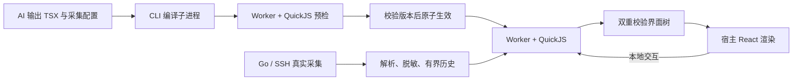

# AI 自定义实时监控组件

2026-09-26 首版。AI 可以生成自定义 TSX，看板展示卡片、趋势、表格、状态和本地交互。采集和历史由 Go 管理，刷新数据不调用 AI。架构依据见 [设计文档](custom-monitor-components-architecture.md)。

新建组件使用已实现的 [数据管线 v2](monitor-data-pipeline-v2.md)：先在 SSH 下实际试采，再由本地解析、映射并验证组件。下面的 data 契约/SDK v1 示例仅用于理解已有组件；新的 AI 生成接口、算子、绑定和验证方式见 v2 文档。

## 使用

连接 SSH 后，在实时监控区域或 AI 对话中提出需求，例如：

> 做一个 Nginx 实时看板，显示连接数、请求速率和最近十分钟趋势，支持展开明细。

AI 会按远端实际能力选择只读采集命令、声明字段并编写组件。先编译和预检，通过后才启用；采集失败会显示未知和诊断，不能把缺失指标变成零。指标是否可采集取决于目标主机已有命令、服务配置和权限。

采集命令仍经过保守的只读校验。校验通过 Shell 语法识别静态 AWK 程序，区分括号中的简单数值比较（如 `if(x+0>9007199254740991)`）与写文件重定向；实际命令保持原样。无法明确识别的脚本继续使用原有校验，不把引号内的代码一律放行。

可继续要求“把连接数放大”“换成两列布局”“加一个展开按钮”。修改时旧版本继续运行，候选失败不会替换原组件。每个组件保留“查看原始输出”，便于核对。

组件生效后自动保存在连接配置目录的 `monitor-widgets/`，每个定义保留最近 10 个版本。点击“监控历史组件”可在同一主机下重新添加，或对当前同一组件应用旧版本。恢复仍需通过命令校验、编译和预检；只保存定义和源码，历史样本不落盘。保存失败会独立提示，可重试，当前运行中的组件继续显示。

## 实际运行链路



生成代码只进入 QuickJS VM，不在主页面、Node 或原生桥上下文执行。Worker、QuickJS WASM 和 SDK 均随应用打包，无需 CDN。VM 不提供网络、文件、DOM、原生桥或命令执行接口。宿主仅把允许的交互值回传给 VM。

编译器只解析源码与内置 SDK，不读取任意模块或执行代码；编译在有超时和输出上限的独立 CLI 进程中进行。Worker 和 VM 各自有执行限制。渲染结果在 VM 出口和宿主入口校验，只允许受控标签、属性、样式和事件；禁止 HTML 字符串、资源 URL、全局 CSS 和原生桥属性。

组件预检覆盖无样本、错误状态及按契约构造的若干测试值，这些测试值不进入采集记录。生效前再次核对候选 ID、面板绑定及定义版本。采集结果另以绑定、来源版本和运行 ID 核对，丢弃旧命令晚到的结果。预检不能证明组件对所有未来数据均能正确运行；运行时错误停止该组件展示，后端采集继续。

## 作者 API

组件通过专用 `@wrd/monitor-ui` SDK 编写；支持 TSX 函数组件，但不支持 React Hooks 和任意 npm 依赖。

入口推荐 `export default defineWidget({initialState, render})`，也支持 `export default function Widget(context) { ... }` 的同步渲染函数。内置卡片和图表需要显式导入，不是全局变量。初始化、渲染和交互异常会显示具体原因；只有确实触发执行时限时才报告超时。AI 在首次请求和后续修改时都会收到完整的 SDK 说明。

```tsx
import { defineWidget, MetricCard, LineChart } from '@wrd/monitor-ui';

export default defineWidget({
  initialState: { details: false },
  render({ data, history, state, setState }) {
    return <section style={{ display: 'grid', gap: 12 }}>
      <MetricCard label="连接数" value={data?.connections ?? null} unit="个" />
      <LineChart label="最近十分钟" series={history.series('connections')} />
      <button onClick={() => setState({ details: !state.details })}>
        {state.details ? '收起' : '展开'}
      </button>
      {state.details && <p>指标来自当前 SSH 采集。</p>}
    </section>;
  },
});
```

内置 `MetricCard`、`StatusBadge`、`LineChart`、`BarChart`、`DataTable`；支持受控 HTML/SVG 组合和 Grid/Flex。`data` 是本次有效数据或 `null`；`lastGoodSample` 提供上次成功值及时间；历史通过 `history.series(name)` 获取。状态只用于筛选、展开、排序等本地交互；采集或 AI 操作使用宿主现有入口。作者类型参考 `internal/widgets/sdk.d.ts`，实际允许的标签及样式以 `frontend/src/widgets/protocol.ts` 为准。

采集契约支持：

| 格式 | 内容 |
| --- | --- |
| `kv` | 每行 `NAME=value`，数值不附加单位 |
| `json` | 一个完整对象；拒绝重复键、未声明字段及尾随内容 |
| `text` | 一个字符串字段，保留旧文本采集能力 |

字段类型为 `number`、`string`、`boolean`、`table`；table 使用 JSON 标量对象数组。可声明单位、可空性及数值历史。大整数使用字符串。前后端都不从展示文本猜测业务单位，也不从模型文本生成真实样本。

## 首版限制与后续项

- 单面板使用一个 SSH 采集源；实时展示和现有告警任务保持各自生命周期。此版本未增加类型化字段告警、多源关联或跨主机看板。
- 每次采集输出最多 256 KiB，结构化快照最多 64 KiB；历史最多 10 分钟、600 点、20 个数值字段且不超过 128 KiB。断线或无效采样形成图表缺口。
- 每个 VM 32 MiB 内存上限；初始化代码预算 200 ms，render/event 预算 50 ms；Worker 超时负责额外终止。首次 Worker/WASM 加载超时为 10 秒。并发 Worker 最多 4 个，等待队列最多 32 个。
- TSX 源码最多 128 KiB，编译结果最多 512 KiB，界面树最多 2000 个节点、32 层、256 KiB；表格最多 1000 行，宿主按 25 行分页。
- 普通数据刷新保留组件状态。组件重建、切换源码、切换隐藏页签后重新挂载时恢复初始状态；尚未实现跨版本状态迁移，`stateVersion` 先用于版本声明。
- 桥接层按制品 hash 和数据序号去重；数据变化后发送有界历史快照，尚未实现逐点增量游标或磁盘历史。定义存储总量限制为 100 MiB，尚无监控历史组件删除界面。
- esbuild 进行 TSX 转译和导入校验，当前不运行完整 TypeScript 语义检查。无任意 CSS、外部资源或第三方库。
- 运行预算是当前限制，不是已完成的跨设备性能基准。后台定时采集沿用原有策略；用户收起/隐藏组件时销毁其 Worker，显示后恢复后端历史。

## 验证与入口

```bash
go test ./internal/widgets ./internal/app ./internal/monitor ./internal/agent ./internal/desktop ./internal/alerts
(cd frontend && npm run build)
mkdir -p .cache
go build -o .cache/widget-test-aissh ./cmd/aissh
node --test scripts/widget-tests/runtime.test.mjs

# 需 Playwright 与浏览器，可使用 PLAYWRIGHT_MODULE / CHROME_PATH。
# WebKit 未安装时该项会显式 skip；本次已安装匹配版本并通过。
node --test scripts/widget-tests/ui.test.mjs

# 有 GUI 的原生桌面环境；使用构建好的 frontend/dist。
go build -tags desktop,production -o .cache/widget-native-smoke ./scripts/widget-tests/native
.cache/widget-native-smoke
```

已验证 Go 数据、历史、版本事务、存储和绑定隔离；QuickJS 中真实编译 TSX、交互、无宿主能力、死循环/内存中断及非法渲染拒绝；Chromium/WebKit 中的预检、实时更新、状态保持、失败版本保留、暗色及窄窗口。macOS 原生 Wails 窗口通过 `wails://wails/` 实际加载生产 Worker/WASM 并完成渲染。浏览器界面自动化使用内存 Wails bridge 和测试采样，不代表已连接用户的业务主机；Windows/Linux 原生环境尚未验收。

| 代码 | 职责 |
| --- | --- |
| `internal/widgets/` | 编译与 SDK、字段解析、历史、版本存储 |
| `internal/app/widgets.go` | 候选编译、生效事务及失效处理 |
| `internal/desktop/widgets.go` | 会话制品/数据缓存、持久化和恢复 |
| `frontend/src/widgets/` | Worker/VM、协议校验、渲染器、监控历史组件 |
| `internal/agent/widget_prompt.go` | 向 AI 声明实际能力和生成规范 |
| `scripts/widget-tests/` | VM、浏览器和原生运行验证 |
