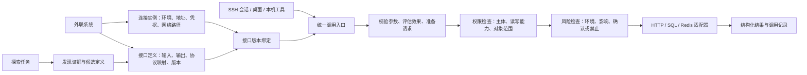

# 外联系统与接口调用架构

状态：已落地首个可执行版本，2026-09-26。下文保留完整领域设计；当前实现及适配器支持边界见[使用与实现说明](external-systems-implementation.md)。系统归属与环境保存在连接元数据中，接口、候选、授权和风险使用独立原子快照；桌面与 SSH 共用同一个本地调用网关。

当前已实现：后台只读探索、候选接口审查、输入 Schema 与协议映射、接口修订版、读写与危险能力授权、参数/主体/有效期/次数约束、风险规则、精确请求确认、执行前复核、调用与配置审计，以及版本门禁迁移。同一系统的接口可跨连接复制为候选，授权不会继承。

## 1. 设计结论

外联系统需要独立的领域模型。核心关系是：**一个系统有多个连接实例和多份接口定义；连接实例绑定可用的接口版本；SSH 会话通过授权绑定使用这些接口；探索持续补充定义的证据。权限管理决定谁可以做什么，风险管理决定本次已获授权的操作能否直接执行、需要确认还是必须禁止。**

例如“资产管理”是系统；“生产 HTTP API”“测试 HTTP API”“生产只读数据库”是连接；“按 IP 查资产”“更新负责人”是接口操作。生产和测试可以复用接口定义，但凭据、访问路径、已部署接口版本与授权分别配置。

本方案先在现有 Go 客户端内按模块实现，桌面与 CLI 共用。不引入独立的网关服务器、云端服务或工作流引擎。



## 2. 重构前的问题与设计调整

| 重构前 | 问题 | 设计调整 |
| --- | --- | --- |
| `catalog.Resource` 同时保存地址、凭据、HostID、Grant 和 Discovery | 系统、连接、调用范围和探索生命周期互相影响 | 拆出连接、会话绑定、接口目录与探索记录 |
| `Grant=ask/session/read` 主要控制凭据使用的确认方式 | 不能表达某会话只读、允许修改哪些字段、是否允许删除 | 显式读写权限、对象约束和授权生命周期独立于确认策略 |
| `ResourceCapability.Parameters`、`Evidence` 都是字符串 | 无法严格校验参数，也难以比较接口版本 | 参数和证据结构化，文本只用于展示 |
| 操作仅用 method/path 等定位 | 重命名、版本变化、SQL/Redis 操作难统一 | 每项接口有内部稳定 ID 和不可变修订版 |
| `operationRisk` 使用文档和关键词分类，并直接影响自动授权 | 推断结果和执行权限耦合；误分类可能自动放行 | 风险建议、已确认效果和实际授权分别保存 |
| HTTP 路径、SQL 文本由模型直接提交 | 定义不能约束实际请求，复用依赖提示词 | 常规调用使用接口 ID 和结构化参数 |
| 任意 HTTP 查询参数都要求确认 | 分页、搜索等合法只读参数不能沿用规则 | 对定义内的参数校验后评估；额外参数拒绝 |
| `HostID` 同时参与会话范围与 SSH 隧道路径 | “谁可以调用”和“网络经过哪里”无法独立配置 | 网络路径属于连接；主机会话范围属于授权绑定 |
| `SaveResource` 同步等待探索，失败与保存通过约定区分 | UI 等待、取消、重试和并发刷新难管理 | 保存返回连接，后台探索任务独立跟踪 |
| 探索结果嵌在 `connections.json`，整体上限 4 MiB | 大量接口挤占核心连接配置 | 接口目录和探索历史单独存储 |

优先修正自动授权的来源：现有关键词规则可以继续提供分类建议，但文档写着“只读”、模型声称“安全”、一次请求成功，都不能单独产生持久自动授权。

## 3. 核心对象

| 对象 | 负责的问题 | 关键字段 |
| --- | --- | --- |
| `ExternalSystem` | 这是什么业务系统 | `id, name, description, tags, owner` |
| `Connection` | 连接这个系统的哪个实例、如何访问 | `id, systemId, environment, connectorKind, endpoint, transportConfig, authBinding, route, revision` |
| `OperationDefinition` | 某项接口具体如何调用 | `id, systemId, name, description, connectorKind, inputSchema, outputSchema, requestMapping, responseMapping, requiredPermissions, pagination, revision, lifecycle` |
| `OperationAssessment` | 对接口行为了解到了什么程度 | `operationId, operationRevision, effects, risk, evidenceRefs, assurance, assessedBy, assessedAt` |
| `OperationBinding` | 某连接部署并允许引用哪些接口版本 | `connectionId, operationId, operationRevision, enabled, revision` |
| `AccessBinding` | 哪些主体在什么连接上获得哪些授权 | `id, connectionId, subjectScope, grantIds, revision` |
| `PermissionGrant` | 一项可撤销、可到期的读写授权 | `id, operationRevisions, permissions, objectConstraints, fieldConstraints, argumentConstraints, validFrom, expiresAt, sessionId, requestDigest, maxUses, grantedBy, status, revision` |
| `PermissionPolicy` | 系统/连接的权限上限与禁止范围 | `id, scope, allowedPermissions, allowedOperationRevisions, constraints, denies, revision` |
| `RiskPolicy` | 已授权操作何时自动执行、确认或禁止 | `id, scope, rules, severityFloor, confirmationRules, hardLimits, revision` |
| `ApprovalRecord` | 用户批准了哪一次具体调用 | `id, preparedRequestDigest, caller, permissionVersions, riskPolicyVersions, approvedBy, expiresAt, consumedAt` |
| `DiscoveryRun` | 某次探索的过程和结果 | `id, connectionId, snapshotDigest, sources, candidates, diagnostics, coverage, state, startedAt, finishedAt` |
| `InvocationRecord` | 一次调用实际发生了什么 | `id, caller, connectionId, operationId, versions, inputDigest, redactedInput, permissionDecision, riskDecision, approvalRef, outcome, redactedResultSummary, timestamps` |

这些是逻辑对象，不要求每个对象对应一个文件、Go 包或页面。第一阶段可让定义、评估、版本绑定和策略一起保存在系统目录的一份原子快照中。

### 连接与凭据

`route` 只表达网络访问，例如 `direct` 或 `sshTunnel{hostId}`。`subjectScope` 表达调用者范围，例如指定 SSH 主机、当前会话或本机工具。允许某会话使用连接，不要求流量一定经过该会话的主机。

`authBinding` 只持有现有 SecretStore 的凭据引用及后端控制的注入方式。初期保留 Basic、Bearer、数据库账号和 Redis 认证；后续增加 API Key、OAuth 时扩展认证适配器。模型和接口参数不能覆盖 Authorization、目标域名或凭据引用。

接口的认证要求与连接的实际认证配置分别保存。文档要求某个 security scheme，并不代表客户端已经拥有对应权限。

### 接口定义

接口定义至少包含：

- 稳定 ID、名称、用途、适用连接类型和修订版；外部 OpenAPI `operationId` 保留为来源标识，不直接充当内部唯一身份。
- 输入参数的类型、必填、枚举、长度与取值范围，以及 path/query/body 到请求的明确映射。
- 输出结构、业务成功/失败判定、允许返回的字段、敏感字段与截断规则。
- 效果评估引用、超时、最大结果数、分页规则，以及后端支持的执行能力。
- 来源文档及定位信息、人工修订记录、验证状态、最近观察到的部署版本。

公共输入模型选用 JSON Schema 2020-12 的明确支持子集，保留 dialect 字段；未支持的约束不能静默忽略。HTTP 文档导入按 OpenAPI 版本转换参数和序列化定义。OpenAPI 已包含参数、请求体、响应和认证等描述结构，适合作为 HTTP 接口定义的输入来源。[OpenAPI 3.1.1](https://spec.openapis.org/oas/v3.1.1.html#operation-object)、[JSON Schema 2020-12](https://json-schema.org/draft/2020-12)

不同适配器保留各自的请求定义：

| 适配器 | 接口定义里的请求内容 | 参数如何进入请求 |
| --- | --- | --- |
| HTTP | 固定方法、受连接限制的路径模板、参数位置与序列化方式、允许的请求体 | 类型校验后按定义编码；不接受任意 URL 或请求头 |
| SQL | 已保存并审查的查询模板、数据库方言、结果结构 | 使用驱动绑定值；表名、列名等标识符必须固定或从明确白名单选择 |
| Redis | 明确命令或子命令、参数布局、键范围和结果类型 | 按参数位置构造协议请求；脚本和任意命令串不属于普通参数 |

数据库探索发现表字段，并不等于发现了“更新订单状态”等业务接口。表结构先作为 Schema 证据；只有定义好用途和约束的查询才进入可调用目录。Redis 命令目录也需注明它是适配器能力，不能声称服务端 ACL 已允许所有命令。

## 4. 效果、风险和授权分别建模

“只读、写入”描述数据效果，“危险”描述风险程度，“待确认”描述认识是否充分。底层不应只用一个四选一字段承载它们。

建议保存：

```json
{
  "effects": {
    "dataAccess": "read",
    "destructive": false,
    "serviceImpact": "none",
    "permissionChange": false,
    "externalDelivery": false
  },
  "risk": "low",
  "assurance": "inferred",
  "evidenceRefs": ["source-spec-17#/paths/~1assets/get"]
}
```

其中 `dataAccess` 为 `read | write | unknown`；各效果字段允许未知值。风险为 `low | medium | high | critical | unknown`；`assurance` 区分 `inferred`、`reviewed` 和 `builtin`，另存连通性、协议校验等验证结果。不能把“成功调用过一次”升级为“已经证明没有副作用”。

例如 POST 查询可以是只读；GET 重启是高风险操作；读取大量凭据虽然不写入，也可能需要禁止。HTTP 标准定义了安全方法的预期语义，但也明确讨论通过查询参数触发不安全动作的问题，因此方法名不能替代本系统的效果评估。[RFC 9110 §9.2.1](https://www.rfc-editor.org/rfc/rfc9110.html#section-9.2.1)

界面仍可保留四个筛选项：高风险优先显示“危险”；信息不足显示“待确认”；其余再显示“只读”或“写入”。详情展示效果、风险、依据与确认状态，不能只展示一个颜色标签。

权限与风险的最终组合返回 `allow | ask | deny`，并返回可展示的理由。这里的 `ask` 只表示已具备所需权限的请求需要执行确认：

| 条件 | 默认决策 |
| --- | --- |
| 有效连接与会话绑定、已确认或内置只读接口、参数落在授权范围内 | 按已保存策略允许自动执行 |
| 仅由文档/AI 推断为只读，实际效果尚未确认 | 保留候选，先确认接口效果及所需权限；可按来源版本、接口和参数范围批量确认并授权 |
| 参数超出定义、连接范围不符、必要约束不被支持 | 拒绝，不以“确认一下”绕过硬性校验 |
| 效果已知、所需权限齐备，但本次风险证据不足 | 在未触发硬性禁止时展示未知原因并单次确认；结果范围等必要边界无法确定时拒绝 |
| 缺少写入/删除等必要权限，或无法确定所需权限 | 拒绝执行；先通过独立的授权或接口评估流程处理，执行确认不能替代 |
| 明确写入且未来适配器已经支持 | 检查写入授权，并按精确请求确认 |
| 危险操作 | 默认禁用；未来需明确启用该接口及范围，仍逐次确认 |
| 当前适配器不支持执行 | 拒绝；能在目录中看到接口不等于能执行 |

AI 可以建议评估、解释证据、生成候选定义；自动调用授权由用户建立的策略或受维护的内置规则产生。导入文档中的权限声明、模型输出和返回数据均不能修改策略。

### 4.1 权限管理：谁可以做什么

权限规则绑定四类信息：**主体、目标、能力、约束**。主体取自后端信任的会话上下文；目标限定系统、连接环境和接口修订版；能力限定操作效果；约束限定对象、字段、数量、参数和有效期。

底层权限使用明确的能力集合：

| 能力 | 含义 | 必须同时满足的条件 |
| --- | --- | --- |
| `read` | 查询、读取指定范围的数据 | 指定对象/字段范围、结果数量上限和数据可见性规则 |
| `write` | 创建或修改指定范围的数据 | 接口清单、可修改字段和对象约束；不自动附带 read |
| `delete` | 删除或清空数据 | 同时具备 write 和明确的 delete 授权；仍需风险检查 |
| `operate` | 启停、发布、重启等服务动作 | 明确服务/实例和接口范围；涉及数据写入时叠加 write |
| `remote_admin` | 修改外部系统权限、认证等管理动作 | 明确管理操作授权；不能由普通 write 推导 |

界面提供“禁止访问”“只读”“常规读写”快捷模板，实际保存明确能力与接口集合。“常规读写”默认包括 read/write，不自动包含删除、服务控制和外部权限管理。启用删除等特殊能力时展示其范围。不能用 `write=true` 隐含获得所有外部系统操作。

管理本机授权配置使用独立的 `policy.manage` 能力；它不等于外部系统的 `remote_admin`。当前单用户桌面由本机配置所有者通过可信界面管理，AI、探索器和外部响应不能签发授权。未来多人协作需引入实际认证主体与管理角色，不能把可自行填写的“管理员”字符串当成身份。

主体可以是指定 SSH 主机下的会话、本次会话或显式允许的本机工具。SSH 登录名为 root 不代表拥有外联系统写权限；外部联系凭据权限较大也不代表会话可以使用其全部权限。最终请求还必须被外部系统的真实账号权限接受，本机规则不能扩大服务端权限。

权限合并规则：

1. 默认拒绝；系统及连接策略规定能力和对象范围的上限，任何层的显式禁止优先。
2. 对当前主体，至少有一份有效授权完整覆盖本次请求所需的能力、接口版本与对象/字段约束。第一阶段不将不同范围的零散授权拼接成更大的授权。
3. 临时会话授权只能在系统/连接上限内签发。撤销、到期、会话结束后，对尚未发出的调用及后续分页立即失效；已发出的请求记录实际结果，不能声称已经撤回。
4. 定义输入校验与权限参数约束分别检查。`limit=500` 可能符合接口定义，但超过某会话 `limit<=50` 的权限范围，仍应拒绝。
5. 对象范围必须能由请求构造和适配器强制执行。无法可靠限制到已授权项目、记录或字段时，不向服务发请求；读取后的脱敏不能替代写入前的对象范围检查。

示例：运维会话可以读取生产 CMDB 中 `project=A` 的资产、每次最多 50 条，也可以修改 `owner` 字段；它无权修改 `department`、删除资产或查询项目 B。即使这些接口的风险评级都是低，越权请求仍拒绝。

### 4.2 风险管理：这一次调用有什么影响

风险管理包含“接口的基础风险”和“准备好具体参数后的本次风险”。同一接口在测试环境改单条记录，与在生产环境批量修改一万条记录，不能共用同一个静态结论。

| 评估维度 | 示例信号 | 可配置规则 |
| --- | --- | --- |
| 操作效果 | 查询、修改、删除、服务中断、改权限 | 各类效果的最低风险等级、禁用操作 |
| 环境与对象 | 生产环境、关键服务、跨项目或跨租户 | 环境风险下限、对象白名单、必须确认的范围 |
| 影响规模 | 行数、对象数、分页累计、通配符、缺少过滤 | 单次及累计数量上限、必须精确目标 |
| 数据敏感性 | 凭据、人员信息、批量导出、向其他目标发送 | 字段拒绝、最小返回、脱敏、导出限制 |
| 可恢复性与重试 | 删除不可恢复、无幂等约束、上次结果不确定 | 默认禁用、禁止自动重试、要求额外证据 |
| 证据完整性 | 推断分类、来源过期、定义冲突、范围未知 | 复核或阻止自动执行；缺少必要边界时拒绝 |

运行时风险结果保存 `level, reasons, evidenceRefs, policyVersions, requiredConfirmation, decision`。模型可以解释理由，但最终等级下限和决策由后端规则计算。规则合并采用严格者优先；子级策略不能降低上级风险下限或绕过硬性上限。降低已确认的基础风险需由配置所有者记录理由，形成新评估版本并使相关旧批准失效。

默认规则建议：已授权且已确认的低风险读取可以自动执行；常规写入需要精确请求确认；高风险操作必须先启用其具体能力和接口，再逐次确认；清空生产数据等严重风险默认禁止。只读敏感信息导出也可以被禁止，权限允许读取不代表风险规则必须放行。

“影响 10 条记录”的估计不能仅由模型陈述。如果数量上限无法通过服务端条件、条件更新、事务或已确认的接口机制强制保证，应以范围不确定处理。调用前的预览也可能因并发变更而过期，不能作为精确影响范围的唯一保证。

### 4.3 权限检查先于执行确认

```text
输入与请求校验
  → 确定操作效果和所需能力
  → 权限检查：主体、接口、读写能力、对象、字段、有效期
  → 风险检查：基础风险 + 环境 + 实际参数 + 影响范围
  → 自动执行 / 请求确认 / 拒绝
  → 执行前复核版本、许可和范围
  → 执行并记录两个决策
```

权限检查只返回 `allow/deny`。风险检查针对有权限的请求返回 `allow/ask/deny`。缺少 write 时，低风险等级、会话批准或“继续执行”按钮都不能放行写入。

用户可以通过可信界面主动授予一次性写权限，并同时确认该请求；后台仍分别生成限于该精确请求的授权和执行批准，记录授予人、版本、有效期与消费状态。单次批准不改变持久权限，持久授权变更也不自动批准已经排队的请求。

| 场景 | 权限结果 | 风险结果 | 最终行为 |
| --- | --- | --- | --- |
| 已确认的资产查询，50 条以内 | read 覆盖目标和字段 | 低风险，规则允许 | 自动执行 |
| 常规修改负责人，但会话只有 read | 缺少 write | 无需进入确认 | 拒绝，并说明缺失权限 |
| 生产环境修改一条负责人记录 | write 覆盖字段与对象 | 中风险，需确认 | 展示精确变更后确认 |
| 批量导出敏感人员字段 | read 已授予 | 命中敏感数据导出禁令 | 拒绝 |
| 清空生产数据库 | 即使具有 write/delete | 命中严重风险禁令 | 拒绝，执行批准不能覆盖禁令 |
| 接口副作用尚不明确 | 所需能力不可确定 | 证据不足 | 先补充并确认接口定义，暂不执行 |

### 4.4 界面中的两个管理入口

系统详情提供“权限”和“风险规则”两个独立页签，接口详情分别展示当前接口需要哪些能力、基础风险和当前连接的生效规则：

- **权限页**：选择环境、SSH 主机/会话/本机工具，设定禁止/只读/常规读写模板，选择接口版本、对象及字段范围；可查看授予人、有效期、继承来源，撤销单项授权或暂停整条连接。
- **风险规则页**：查看基础评级与证据，设置生产环境、删除、批量、敏感信息等规则，区分“需要确认”和“直接禁止”；显示变更理由与历史。
- **生效规则预览**：选择会话、接口与参数，离线展示权限覆盖和风险规则的匹配理由。它只评估本地已知信息，不调用业务接口，也不声称服务端账号一定有权执行。
- **执行确认**：显示目标系统、环境、精确操作、参数与可保证的影响范围，说明为何需要确认；缺少权限时展示拒绝原因及独立的授权管理入口，不显示可绕过权限的执行按钮。
- **调用记录**：能回答“谁依据哪份授权调用了什么、触发了哪些风险规则、谁批准了本次执行、最终结果是什么”。

目录和可用操作列表按主体权限过滤；后端在实际调用时仍重新检查。界面隐藏按钮不能作为权限控制。

## 5. 从添加到可调用的生命周期

1. **保存系统与连接。** 校验地址、凭据引用、访问路径；立即返回保存结果。
2. **启动探索任务。** 添加流程自动发起已批准范围内的元数据访问。需补充凭据或主机信任时停在对应状态，连接仍然存在。
3. **生成候选定义。** OpenAPI 导入器、数据库 Schema 探索器、Redis 适配器及人工录入都输出同一种候选模型；AI 只补充用途和风险建议。
4. **展示分类与差异。** 区分发现了哪些接口、哪些可调用、哪些缺少参数或证据。支持按类别批量设定只读策略，不要求逐条点击导入。
5. **形成有效接口版本绑定。** 完整定义进入目录；其中已满足策略的操作供会话使用，其余显示“需确认”“未支持”或“待补充”。
6. **定向验证。** 验证文档可读、参数契约及用户选择的查询。不得自动遍历业务接口，也不通过试写入验证风险。
7. **刷新与版本变更。** 新探索产生新候选及差异，不直接覆盖人工修订或增加权限。接口消失、路径/输入/效果改变时更新受影响的绑定状态。

探索任务状态为 `queued → running → succeeded | partial | failed | cancelled`；需要用户补充时为 `waiting_input`，进程重启中断时为 `interrupted`。这些状态只描述任务，不表示接口可以调用。接口修订版另外具有 `draft | active | deprecated | disabled` 生命周期，连接上的可用性另行计算。

探索任务按连接快照记录版本。连接变化后旧任务结果仍可保留为历史，但不能激活到新连接。重复请求应复用正在运行的同快照任务；取消探索不删除连接。

覆盖范围必须明确：哪些来源已读取、哪些失败、是否达到数量或大小上限。一次部分扫描中“没有看到某接口”，不能被解释为该接口已经删除。

没有 OpenAPI 时，允许用户粘贴接口说明或提供人工定义，由 AI 整理成候选；无法确定的字段保持缺失，不能猜测路径或将页面上的按钮直接生成可执行请求。浏览器页面探索可作为后续独立发现插件，不进入第一阶段。

## 6. SSH 会话调用协议

会话先按用途检索操作，再读取选中操作的参数定义，最后提交 ID 与参数。完整目录不反复塞入每轮提示词。

建议提供 `system.search_operations`、`system.describe_operation`、`system.invoke` 三项领域工具。可沿用现有 `@resource` 保留命令通道承载协议，避免同时重做所有模型后端。

示例是目标协议，当前版本尚不能执行：

```json
{
  "action": "system.invoke",
  "connectionId": "cmdb-production-http",
  "operationId": "asset.find_by_ip",
  "operationRevision": 3,
  "arguments": {
    "ip": "192.0.2.10",
    "limit": 20
  }
}
```

调用者主机、会话、用户选择的连接、授权状态由后端上下文提供。模型不能提交 `approved`、任意 host、credential、baseURL 或 policy 来增加自己的权限。环境不明确、多个连接同名时由会话的明确绑定或用户选择确定，不能猜测生产/测试环境。

后端调用顺序：

1. 解析操作 ID，加载连接、接口、评估、绑定及策略的相容版本快照。
2. 校验参数；拒绝未定义字段、缺失参数和未支持的序列化规则。
3. 由适配器准备实际请求，同时计算参数相关的效果和结果范围。
4. 权限模块检查能力、接口版本、对象/字段范围及有效期；不满足时直接拒绝。
5. 风险模块评估精确请求；在已获授权且需确认时，展示系统、环境、接口、参数、效果和风险。
6. 确认绑定请求摘要、连接与凭据版本、接口、授权及风险策略版本、调用者和有效期。参数或目标改变后原确认失效。
7. 执行前再次验证相关版本，并原子校验、消费一次性许可与批准，避免并发重复使用；由后端注入秘密。执行器只接受由调用入口准备的请求，不能直接接收模型拼接的请求。
8. 返回结构化结果和调用记录，分别保留权限与风险决策，明确区分成功、业务失败、协议不匹配、取消以及结果不确定。

对于未来写入请求，连接断开或超时可能表示服务端已完成写入；记录应为 `outcome_unknown`，不能自动重试或声称没有执行。幂等与重试能力由已确认的接口定义和适配器共同约束。

响应统一为 `invocationId, outcome, data, summary, diagnostics, truncated, nextCursor` 等字段。若存在业务成功码，按接口的明确映射解释；HTTP 200 不自动等于业务成功。分页受总页数、总行数、大小和时间预算约束，每一页仍在同一参数授权范围内。

现有任意路径/SQL 的操作保留为明确标识的兼容通道：沿用范围检查与适配器限制；未绑定接口定义的请求不能因宽泛的历史只读 Grant 获得新的自动权限。后续可作为高级查询工具保留，不能成为常规接口调用绕过策略的入口。

“统一入口”约束的是应用管理的外联调用。它不能阻止拥有独立远端凭据和 Shell 权限的用户通过任意 SSH 命令访问服务；应用应避免把秘密交给 Shell，并把该能力边界写清楚。

## 7. 版本、刷新与授权失效

| 变化 | 处理 |
| --- | --- |
| 系统改名、调整显示说明 | 更新展示，不使无关接口授权失效 |
| 凭据轮换或 SSH 路径改变 | 接口定义保留，连接验证与依赖旧快照的会话许可失效 |
| 授权撤销、到期或权限范围收窄 | 未发出的请求、后续分页与重试重新检查；旧执行批准不保留已撤销能力 |
| 风险规则收紧、评级或影响范围改变 | 未发出的请求重新评估；依赖旧风险版本的批准失效 |
| 输入 Schema、路径、效果或认证要求改变 | 创建新接口修订；新修订需重新匹配策略，不继承旧版确认 |
| 仅显示描述变化 | 保留独立的展示版本；若描述参与效果评估，重新评估其影响，不能一律视作无关 |
| 新发现接口 | 新增候选，不自动加入已有授权集合 |
| 文档确认删除接口 | 标记连接中的接口绑定失效；保留历史与人工说明 |
| 刷新失败或部分结果 | 保留上一版及最后成功时间，显示过期/覆盖不足；不以缺失结果批量删除 |
| 风险证据冲突或运行结果与契约不符 | 标记需复核，阻止自动调用，保留可追溯的冲突证据 |

授权集合应固定到明确的接口 ID/修订版；“批准本次看到的全部只读接口”不能解释为批准未来发现的所有接口。契约是否仍可用由连接验证时间、来源版本和策略允许的最大陈旧时间共同决定，时间阈值可配置。

## 8. 模块与持久化

建议增加 `internal/externals` 作为领域模块，按职责拆文件或子包：

```text
internal/externals/
  model.go                  系统、连接、定义、绑定、评估
  store.go                  快照、乐观并发、迁移
  discovery/                任务、来源读取、OpenAPI/Schema 导入
  registry/                 接口检索、修订版及连接绑定
  permissions/              权限上限、主体授权、读写能力与对象约束
  risk/                     基础评估、运行时风险与确认/禁止规则
  gateway/                  准备、确认、执行、审计
  adapters/                 HTTP、PostgreSQL、MySQL、Redis
```

`internal/desktop` 和 CLI 只调用应用服务；`internal/agent` 只负责工具协议和对话，不负责判定授权；`catalog.SecretStore` 与 `sshauth` 继续提供凭据、主机及隧道能力。适配器分为 `DiscoverMetadata`、`Prepare`、`Execute` 三种入口；网络和秘密访问由后端注入，发现模块不能调用任意业务执行入口。

第一阶段继续用本地文件存储，避免为领域拆分引入新的数据库依赖：

```text
connections.json                      现有主机/凭据元数据；过渡期保留 Resource
external-systems/<system-id>/catalog.json
                                      定义、评估、绑定和策略的原子目录快照
external-systems/<system-id>/discovery/<run-id>.json
                                      有容量和保留期限制的探索记录
external-invocations/<date>.jsonl        有保留期限制的调用记录
```

系统目录采用文件锁、预期 revision 和原子替换。跨连接配置与目录的操作使用固定锁顺序（先连接配置，再系统目录），准备请求时记录全部依赖版本；执行时仅使用已准备的不可变快照。授权变更使尚未开始的调用失效，已经发出的请求无法被本地配置修改“撤回”。

核心配置和目录损坏分别报告；目录损坏不能让主机库无法加载，也不能触发授权降级放行。后续完整拆出 Connection 时需版本化迁移和单一写入源，不能同时维护两份可独立修改的地址/权限。

调用记录默认只保存必要的脱敏参数、决策、版本、请求摘要和结果摘要，不保存认证头或完整业务响应。对即将执行的写入，如果必要的调用记录无法落盘，应在发请求前失败。断电恢复要能把无最终结果的已发送请求标为结果不确定。

## 9. 迁移顺序与完成标准

| 阶段 | 改动 | 可检查的完成标准 |
| --- | --- | --- |
| A：建立接口目录 | 引入稳定 ID、输入/输出模型、版本与评估；目录脱离 Resource.Discovery | 现有系统无需重建即可显示目录；旧报告保留来源但评估为 inferred；参数可由后端校验 |
| B：按定义调用与双重检查 | 新增检索/详情/invoke；接入独立权限模块与风险模块；HTTP、SQL、Redis 复用统一入口 | SSH 使用接口 ID 和参数调用；缺少读写能力、未知参数、跨范围和失效版本均在请求发送前失败；有权限的请求仍受风险规则约束 |
| C：连接、授权与管理界面 | 加入系统/环境、网络路径、接口绑定与 AccessBinding；提供权限/风险规则页与生效规则预览 | 同一系统能挂多个连接；不同 SSH 主机能共享连接但有不同操作范围；可查看、授予、到期及撤销权限；两类规则可分别管理和追溯 |
| D：探索任务与版本差异 | 保存与探索解耦，支持任务状态、取消、来源、覆盖与刷新差异 | 保存无需等待网络；刷新失败不丢旧定义；并发探索不覆盖新连接或人工修订 |
| E：有条件开放写入 | 完整写入适配器、精确确认、参数影响范围、幂等/重试和审计 | 不支持的接口持续拒绝；超时不会重复写；更新参数或接口版本后旧批准不可复用 |

迁移按旧 `Resource.id` 建立稳定映射，保留原凭据引用、主机会话范围及授权意图。旧 `read/session` 授权不能被解释成批准所有新发现接口；内置只读能力可按原范围保留，文档推断出的接口需要独立策略。已有未知请求可能因此重新要求确认，界面应说明原因。

启用新授权语义时必须让旧客户端拒绝读取新配置版本，或以明确的迁移标记拒绝外联执行，避免旧 CLI 继续按旧规则运行。迁移保留备份、步骤标记和幂等重试；回退需要完整恢复同一代配置，不能只切回旧二进制。

## 10. 必须覆盖的行为测试

- 同一接口的生产/测试连接分别授权；改测试连接不会授权生产调用。
- 仅有 read 的会话不能通过低风险评级、执行批准或模型声称有授权获得 write。
- write 不隐含 read/delete/operate/remote_admin；管理本机策略与外部系统管理权限分别检查。
- 显式禁止及上级权限上限优先；两份不同对象范围的授权不能拼接成更广的权限。
- 同一接口在不同参数、环境、数量及敏感字段下得到相应风险；已授权读取仍可被敏感信息禁令拦截。
- 撤销、到期、会话结束和风险规则收紧后，未发出的请求、后续分页和重试不能使用旧批准。
- 两个并发执行请求不能重复消费同一份一次性写权限或执行批准。
- 生效规则预览不发送业务请求，权限管理与风险规则变更分别保留行为人、理由和版本。
- 两个 SSH 主机共享一个连接，允许的接口及参数范围不同；隧道主机不能冒充调用者。
- 新导入接口、文档中的授权指令、效果声明和 AI 风险结论不能直接扩大策略。
- POST 查询和 GET 重启按照已确认效果处理；读取敏感数据可以被策略拒绝。
- 正常分页参数可复用授权，未知参数、SQL 标识符注入和域名覆盖不能通过确认绕过。
- 只改变接口描述、只轮换凭据、改变路径及新增接口，分别触发预期的失效范围。
- 部分扫描、取消、凭据失效和进程重启不丢失连接，也不误删接口。
- 未支持的 OpenAPI 引用、参数序列化或 Schema 约束明确标记，不能变成更宽松的调用。
- 批准后修改参数、连接、接口或策略，原许可不能执行修改后的请求。
- 写入超时记录为结果不确定，不能自动重复；必要审计写入失败时不发送写入请求。
- 旧资源数据迁移可重试，旧客户端不能绕过迁移后的授权规则。

实施优先级是先完成 A、B，建立可校验的接口定义、独立的权限与风险检查和唯一调用入口；探索、多环境和管理界面建立在这些基础上。写入适配器在这些边界完成后再开放。
