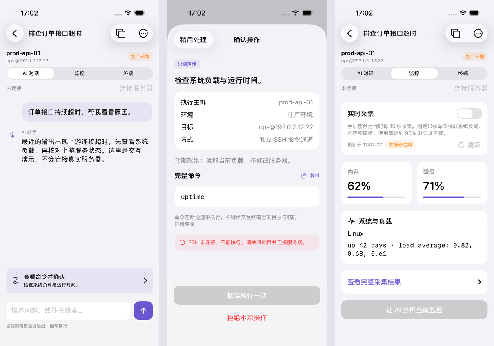

# WRD AI SSH for iPhone

原生 SwiftUI / UIKit 客户端，iOS 17+。iPhone 直接连接 SSH 服务器，并直接通过 HTTPS 调用配置的 AI 模型。运行时不需要电脑、不需要桌面端，也不需要本项目的中转服务。

原生模拟器截图（离线演示数据）：



## 使用

1. 在「主机」中添加地址、端口、用户名和环境。支持密码、OpenSSH Ed25519 / RSA 私钥及私钥口令；可从「文件」导入私钥，也可配置已有主机作为跳板。
2. 点击主机创建会话。首次连接必须核对 SHA256 指纹；指纹改变时拒绝连接，不能点击直接覆盖。
3. 在「设置 → AI 服务」配置 HTTPS 地址、模型名称和 API Key。使用 Chat Completions 兼容接口，要求支持 SSE 流式回答与 function calling。地址支持服务根路径（例如 `https://api.example.com/v1`）或完整 `/chat/completions` 地址。
4. 在会话内切换「AI 对话 / 监控 / 终端」。AI 不可用时仍可直接操作 SSH。终端是原生 VT/xterm 视图，支持键盘输入、选取复制、屏幕旋转、窗口大小调整及 Esc / Tab / Ctrl+C / 方向键。
5. AI 命令需要进入独立确认页，显示完整命令、目标和环境。未知或非简单只读命令还需核对主机名。批准后手机在同一 SSH 连接的独立 exec 通道执行一次，结果继续交给 AI 分析。

命令使用独立子 Shell，不继承交互终端的 `cd` 或临时环境变量。交互式 `sudo`、MFA、口令追问等请在终端手动处理；首版登录认证不支持 keyboard-interactive MFA，也不提供文件传输、SSH Agent 或端口转发界面。

## 数据与运行范围

- 密码、私钥、口令和 AI Key 存放在 `WhenUnlockedThisDeviceOnly` 钥匙串；连接信息与对话保存在 App 私有目录，使用完整文件保护并排除备份，不同步 iCloud。
- AI 请求直接发往你配置的服务。开启「附带最近终端输出」时发送最近最多 8,000 字符；已读取的登录秘密会被替换。未知秘密仍可能存在于服务器输出中，可关闭此开关。
- 不自动执行 AI 建议，不因网络重试重复提交命令；未取得完成标记、超时或断线时显示「状态未知」。切后台、断线或重连会使原确认失效。
- 监控由手机在前台执行固定只读采集命令，每 15 秒刷新。Linux 提供内存使用率，磁盘使用率通过 `df` 获取；未提供的指标显示缺失。内存或磁盘达到 90% 时记录本机告警。
- iOS 会限制后台网络任务。应用切到后台会保存状态并停止 AI 与监控；有限后台时间耗尽后关闭 SSH，回到前台可手动重连。不能承诺锁屏后持续 SSH、持续监控或后台推送告警。
- 可开启 Face ID / Touch ID / 设备密码解锁；切出应用时遮挡敏感界面。远端终端控制序列不能读取手机剪贴板；粘贴先预览。

## 构建

打开 `ios/WRDAISSH.xcodeproj`，选中 `WRDAISSH` scheme。首次构建由 Swift Package Manager 下载依赖；锁定版本保存在 `Package.resolved`。需要支持 Swift 6.3 的 Xcode（本次使用 Xcode 26.6），以及 Xcode Metal 编译组件：

```sh
xcodebuild -downloadComponent MetalToolchain
```

项目本身以 Swift 5 语言模式编译；原生依赖使用当前 Swift 工具链。

```sh
xcodebuild -project ios/WRDAISSH.xcodeproj -scheme WRDAISSH \
  -destination 'platform=iOS Simulator,name=iPhone 17 Pro' \
  -derivedDataPath .cache/ios-build \
  -clonedSourcePackagesDirPath .cache/ios-packages \
  CODE_SIGN_IDENTITY=- CODE_SIGNING_ALLOWED=YES build
```

真机运行需要在 Xcode 的 Signing & Capabilities 中选定自己的 Apple Development Team，并将 Bundle Identifier 调整为团队可用值，然后选择已配对的 iPhone 运行。项目没有填写他人的签名身份、没有上传 App Store，也没有自动注册设备。

如果需要通过本机 1080 SOCKS 代理下载 GitHub 依赖，可仅对本次命令设置代理，不修改全局 Git 配置：

```sh
env GIT_CONFIG_COUNT=1 GIT_CONFIG_KEY_0=http.proxy \
  GIT_CONFIG_VALUE_0=socks5h://127.0.0.1:1080 \
  xcodebuild -resolvePackageDependencies \
  -project ios/WRDAISSH.xcodeproj -scheme WRDAISSH \
  -clonedSourcePackagesDirPath .cache/ios-packages
```

`python3 scripts/generate-ios-project.py` 可以根据源文件重新生成已提交的 Xcode 工程，不需要额外安装 XcodeGen。新增 Swift 文件后运行一次；开发者签名设置应在自己的本地配置中保留。

## 验证

本轮 18 项模拟器测试全部通过，iPhone ARM64 Release 编译通过。具体范围与未实测项目见 [验证记录](VALIDATION.md)。

在仓库根目录运行（可通过 `IOS_DESTINATION` 选择已安装的模拟器，`GO_BIN` 指定 Go 编译器）：

```sh
bash scripts/test-ios.sh
```

测试包含主机校验、Keychain 隔离、配置与秘密分离、模型流解析、凭据脱敏、不完整提案拒绝、审批失效、真实 SSH 握手与 PTY 字节往返。SSH 测试服务只绑定回环地址，不执行收到的命令，使用独立的测试账号；不会连接你的生产服务器。

`--demo` 是 Debug 构建的本机交互演示，明确标注示例数据，禁止联网和执行。Release 不包含演示数据入口。

## 主要依赖

- [Citadel 0.12.1](https://github.com/orlandos-nl/Citadel/tree/0.12.1)：SSH 认证、PTY、exec 和跳板通道。
- [SwiftTerm 1.20.0](https://github.com/migueldeicaza/SwiftTerm/tree/v1.20.0)：原生终端视图与 VT/xterm 解析。
- SwiftNIO / NIOSSH / Swift Crypto：异步网络和 SSH 协议实现。

依赖许可证随各 Swift package 提供。分发前需完成自己的签名、目标设备验收、隐私说明及加密出口信息核对。
